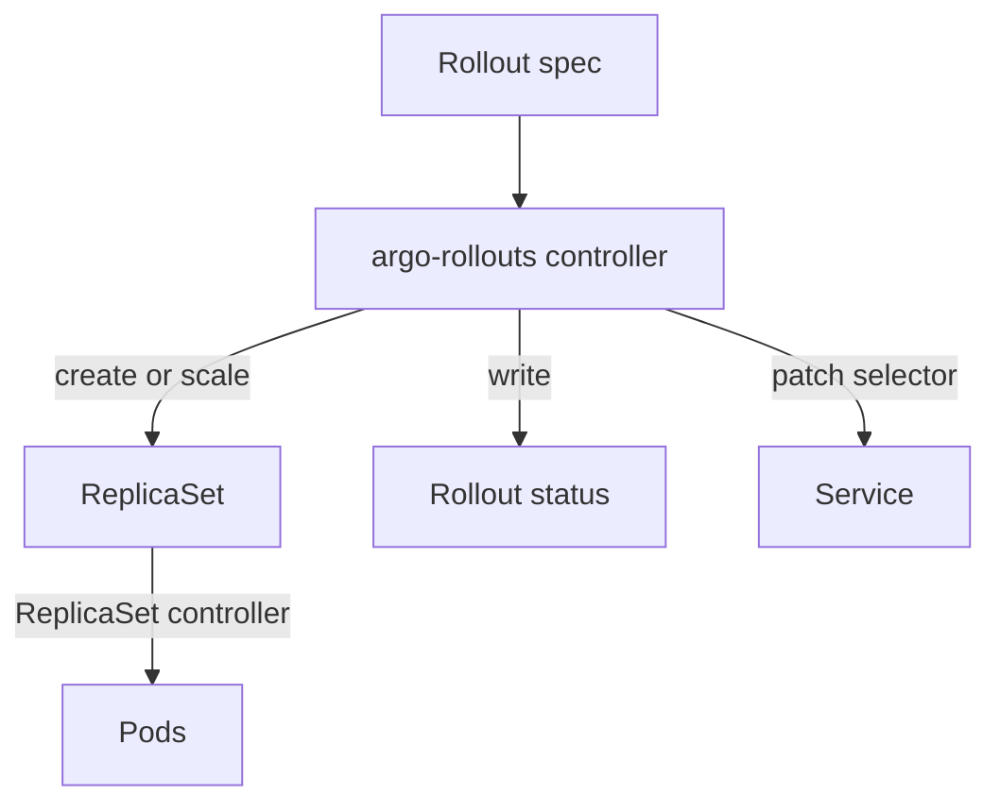

# The Rollout Resource And Its Controller

A Kubernetes `Deployment` replaces pods with a built-in method called a rolling update. The method has two settings, `maxSurge` and `maxUnavailable`, and no way to pause, to measure the new version or to switch traffic in one step. Argo Rollouts adds a second workload resource, `Rollout`, that keeps the Deployment model and adds progressive delivery strategies. This part shows what a `Rollout` contains and which component acts on it.

## A Rollout is a custom resource

A custom resource is an object kind that is not built into Kubernetes. A CustomResourceDefinition (CRD) registers the kind with the API server. Argo Rollouts installs several CRDs in the API group `argoproj.io`: `Rollout`, `AnalysisTemplate`, `ClusterAnalysisTemplate`, `AnalysisRun` and `Experiment`. The API server stores these objects in etcd like any other object, but it does not act on them.

The Argo Rollouts controller does the acting. It is a Deployment named `argo-rollouts` in the `argo-rollouts` namespace. The controller watches `Rollout` objects, creates and scales ReplicaSets, updates Services and writes the result back into the `status` of the `Rollout`. If the controller is not running, a `Rollout` object is stored but nothing happens to it.

The Kubernetes control plane still does its usual work. The ReplicaSet controller (part of `kube-controller-manager`) creates pods for a ReplicaSet. The scheduler places the pods. The kubelet starts the containers. The Argo Rollouts controller only decides which ReplicaSet has how many replicas, and when.

<!-- astrona:playground:renew -->

To see the registered kinds, list the CRDs, then ask the API server to describe the top-level fields of a `Rollout`. The `kubectl explain` command reads the schema from the CRD:

```sh
kubectl get crd | grep argoproj.io
kubectl explain rollout.spec
```

## What a Rollout contains

A `Rollout` spec looks like a Deployment spec. It has `replicas`, a `selector` and a pod `template`. The one new field that matters most is `strategy`. A Deployment accepts `RollingUpdate` or `Recreate` there. A `Rollout` accepts `canary` or `blueGreen`. There is no `RollingUpdate` in a `Rollout`; a `canary` strategy with no steps behaves as the closest equivalent.

Save this as `rollout-demo.yaml`:

```yaml
apiVersion: argoproj.io/v1alpha1
kind: Rollout
metadata:
  name: demo
  namespace: starfleet
spec:
  replicas: 2
  revisionHistoryLimit: 3
  selector:
    matchLabels:
      app: demo
  template:
    metadata:
      labels:
        app: demo
    spec:
      containers:
      - name: demo
        image: docker.io/library/python:3.13-alpine
        command:
        - python
        - -m
        - http.server
        - '8080'
  strategy:
    canary: {}
```

Apply it:

```sh
kubectl apply -f rollout-demo.yaml
```

Then check the result. The first command lists the Rollout, and the second lists the ReplicaSet and pods the controller created:

```sh
kubectl -n starfleet get rollout demo
kubectl -n starfleet get replicasets,pods -l app=demo
```

The Rollout reaches the phase `Healthy` when all replicas of the current revision are available. Because `canary: {}` has no steps, the first revision goes straight to 100 percent.

## Fields that differ from a Deployment

Some fields exist only in a `Rollout`. The list below names the most important ones:

- `spec.strategy.canary` and `spec.strategy.blueGreen`: the two progressive strategies. Exactly one of them is set.
- `spec.workloadRef`: a reference to an existing Deployment. The `Rollout` reads the pod template from it instead of defining its own `template`.
- `spec.paused`: when `true`, the controller stops all progress.
- `spec.restartAt`: a time after which the controller restarts the pods one by one.
- `spec.rollbackWindow.revisions`: how many earlier revisions can be rolled back to without running the analysis again.
- `spec.analysis`: limits for how many successful and unsuccessful AnalysisRuns the controller keeps.

Several fields exist in both resources, with the same meaning: `replicas`, `selector`, `template`, `minReadySeconds`, `revisionHistoryLimit` and `progressDeadlineSeconds`. The default of `revisionHistoryLimit` is 10 and the default of `progressDeadlineSeconds` is 600.

## What the controller does in one cycle

Each time the `Rollout` or one of its ReplicaSets changes, the controller reconciles. A reconcile compares the desired state in the spec with the observed state and makes one change toward the desired state.



The diagram shows that the Argo Rollouts controller changes ReplicaSets, Services and the status, and that the ReplicaSet controller creates the pods.

## Common pitfalls

> [!WARNING]
> Applying a `Rollout` without the controller running stores the object and does nothing else. A `Rollout` and a `Deployment` that select the same pods also compete for them, so give each workload only one owner.
