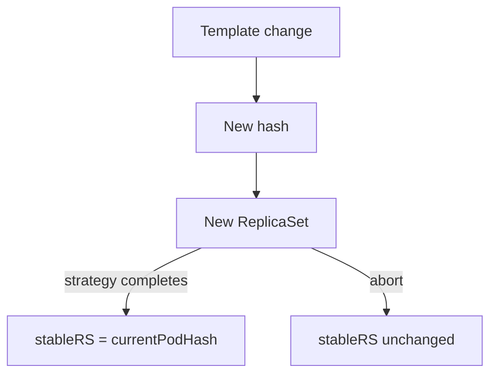

# ReplicaSets, Hashes And Revisions

A Rollout does not run pods itself. Each version of the pod template gets its own ReplicaSet, and the controller moves replicas between those ReplicaSets. This part explains how the controller names and labels them, how it counts revisions and what the status fields mean when a release is in progress.

## One ReplicaSet for each pod template

The controller hashes the pod template (`spec.template`) of the `Rollout`. The hash is a short string such as `6c7d9b5f4`. The controller names the ReplicaSet `<rollout name>-<hash>` and sets the label `rollouts-pod-template-hash` on the ReplicaSet and on its pods. A Deployment uses a similar label called `pod-template-hash`. The Rollout label is different so that the two controllers never confuse each other's objects.

Any change to the pod template produces a new hash and therefore a new ReplicaSet. Changing the image, an environment variable or a label is a template change. Changing `replicas` is not a template change: the hash stays the same and the existing ReplicaSet is scaled.

The ReplicaSet has an owner reference to the `Rollout`. That reference is why `kubectl delete rollout` also removes the ReplicaSets and pods.

<!-- astrona:playground:renew -->

Check the owner and the label on the objects of the earlier example:

```sh
kubectl -n starfleet get replicasets -l app=demo --show-labels
kubectl -n starfleet get replicasets -l app=demo -o jsonpath='{.items[*].metadata.ownerReferences[*].kind}'
```

The second command prints `Rollout` once for each ReplicaSet.

## Revisions

The controller numbers each new pod template. The number is stored in the annotation `rollout.argoproj.io/revision`, on the `Rollout` and on each ReplicaSet. The first template is revision 1. Each template change adds 1. If you return to an older template, the controller reuses the old ReplicaSet and gives it a new, higher revision number.

Save this as `rollout-demo-two.yaml`. It is the same `Rollout` with one environment variable added to the template:

```yaml
apiVersion: argoproj.io/v1alpha1
kind: Rollout
metadata:
  name: demo
  namespace: starfleet
spec:
  replicas: 2
  revisionHistoryLimit: 3
  selector:
    matchLabels:
      app: demo
  template:
    metadata:
      labels:
        app: demo
    spec:
      containers:
      - name: demo
        image: docker.io/library/python:3.13-alpine
        env:
        - name: REVISION
          value: two
        command:
        - python
        - -m
        - http.server
        - '8080'
  strategy:
    canary: {}
```

Apply it:

```sh
kubectl apply -f rollout-demo-two.yaml
```

Then check the revision annotation on the Rollout and on its ReplicaSets:

```sh
kubectl -n starfleet get rollout demo -o jsonpath='{.metadata.annotations}'
kubectl -n starfleet get replicasets -l app=demo -o custom-columns=NAME:.metadata.name,REVISION:.metadata.annotations.rollout\.argoproj\.io/revision,DESIRED:.spec.replicas
```

The ReplicaSet of revision 1 stays in the list with 0 desired replicas. The controller keeps it so that a rollback does not need to create it again.

## Status fields

The controller writes the progress of a release into `status`. Four fields explain most situations:

- `currentPodHash`: the hash of the newest pod template. This is the revision the controller is rolling out.
- `stableRS`: the hash of the last revision that finished successfully. Traffic and the safe fallback point to this ReplicaSet.
- `phase`: one of `Progressing`, `Paused`, `Healthy` or `Degraded`.
- `observedGeneration`: the `metadata.generation` that the controller has processed. When it is lower than the generation of the `Rollout`, the status is still old.

When `currentPodHash` equals `stableRS`, no release is in progress. When they differ, a release is running, paused or aborted. The counters `replicas`, `updatedReplicas`, `readyReplicas` and `availableReplicas` count pods across ReplicaSets: `updatedReplicas` counts pods of the current revision.



The diagram shows that `stableRS` moves to the new hash only when the strategy completes.

## Keeping and removing old ReplicaSets

`revisionHistoryLimit` is the number of old ReplicaSets (with 0 replicas) that the controller keeps. When the number is exceeded, the controller deletes the oldest ones. A low value saves objects but removes rollback targets. A value of 0 keeps none.

A rollback is a template change back to an older template. The controller finds the ReplicaSet that already has that hash and scales it up again. This is faster than creating a new ReplicaSet, because the image is often cached on the nodes already.

## Common pitfalls

> [!WARNING]
> Selecting pods only by `app` matches pods of every revision. Add `rollouts-pod-template-hash` to the selector when you need one revision. A status read right after an apply can be old; compare `observedGeneration` with `metadata.generation` first.
