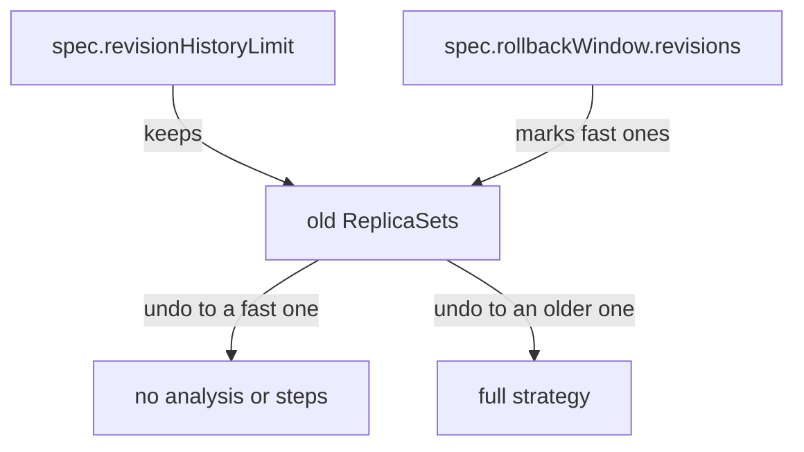

# Timing, Capacity And History Fields

A `Rollout` spec has a small group of fields that do not describe the application. They describe how the controller counts replicas, how long it waits and how much history it keeps. These fields decide when a pod counts as available, when a release counts as stuck and how far back a rollback can go. This part explains each field and which component reads it.

## Replicas and availability

The field `spec.replicas` is the number of pods the `Rollout` wants. If it is not set, the value is 1. The controller applies the number to the ReplicaSets according to the strategy. During a release, the total number of pods can be higher than `spec.replicas`, because the old and the new ReplicaSet both run for a while.

A pod counts as ready when its readiness probe passes. A pod counts as available when it has been ready for at least `spec.minReadySeconds`. The default is 0, so a ready pod is available at once. A value such as 10 makes the controller wait 10 seconds after a pod becomes ready before it counts the pod as available. The status fields `readyReplicas` and `availableReplicas` show the two counts.

Read the three counters of a `Rollout` that runs in the playground:

<!-- astrona:playground:renew -->

```sh
kubectl -n starfleet get rollout mission -o jsonpath='{.spec.replicas} {.spec.minReadySeconds} {.status.readyReplicas} {.status.availableReplicas}{"\n"}'
```

An empty value for `minReadySeconds` means the field is not set and the default of 0 applies.

## The progress deadline

The field `spec.progressDeadlineSeconds` is the time the controller allows for a release to make progress. The default is 600 seconds. Progress means that a new ReplicaSet is created, scaled up, or that its pods become available. When no progress happens for the whole deadline, the controller sets the condition `Progressing` to `False` with the reason `ProgressDeadlineExceeded`, and the phase becomes `Degraded`.

By default, the controller only reports the problem. The pods of the new revision stay in place. If you set `spec.progressDeadlineAbort: true`, the controller also aborts the release when the deadline passes, so the `Rollout` returns to the stable revision. The abort uses the same mechanism as a manual abort.

Set a short deadline on the playground `Rollout` and read it back:

```sh
kubectl -n starfleet patch rollout mission --type merge -p '{"spec":{"progressDeadlineSeconds":120}}'
kubectl -n starfleet get rollout mission -o jsonpath='{.spec.progressDeadlineSeconds}{"\n"}'
```

A change to this field is not a change to the pod template, so it does not start a release.

## History and rollback

The field `spec.revisionHistoryLimit` is the number of old ReplicaSets that the controller keeps, scaled to zero. The default is 10. These ReplicaSets are the targets of an undo.

The field `spec.rollbackWindow.revisions` is a different limit. It says how many of the most recent revisions count as a fast rollback. When a release goes back to a revision inside the window, the controller skips the analysis and the pause steps of the strategy and moves to the old revision directly. The assumption is that the old revision was already proven. A revision outside the window goes through the full strategy again.

The two fields work together. A rollback window of 3 needs a history limit of at least 3, because the controller can only use a ReplicaSet that still exists.



The diagram shows that the history limit decides which ReplicaSets exist and the rollback window decides which of them skip the strategy.

## Restarting pods

The field `spec.restartAt` holds a timestamp. When the time passes, the controller restarts the pods of the `Rollout` one at a time, so the `Rollout` stays available. The controller records the time it acted on in `status.restartedAt`. The restart does not change the pod template, so it creates no new revision and no new ReplicaSet. The plugin command `kubectl argo rollouts restart` sets this field.

Check whether a restart has ever run:

```sh
kubectl -n starfleet get rollout mission -o jsonpath='{.spec.restartAt} {.status.restartedAt}{"\n"}'
```

Both values are empty when no restart has been requested.

## What the fields have in common

Each field in this part changes what the controller does, and none of them changes the pods. For this reason none of them creates a revision. The hash of the pod template is the only thing that starts a release. A change to `replicas` scales the current ReplicaSet. A change to `minReadySeconds` or `progressDeadlineSeconds` is read on the next reconcile. A change to `revisionHistoryLimit` makes the controller delete the extra old ReplicaSets at once.

You now know the fields that control timing, capacity and history. The next question is which parts of the pod template start a new revision and which parts of the metadata the controller can change without starting one.

## Common pitfalls

> [!WARNING]
> `progressDeadlineSeconds` must be higher than `minReadySeconds`, or the controller may report no progress while pods wait to become available. Lowering `revisionHistoryLimit` deletes old ReplicaSets immediately, and an undo to a deleted revision is not possible. A `Degraded` phase caused by `ProgressDeadlineExceeded` does not abort the release unless `progressDeadlineAbort` is `true`.
