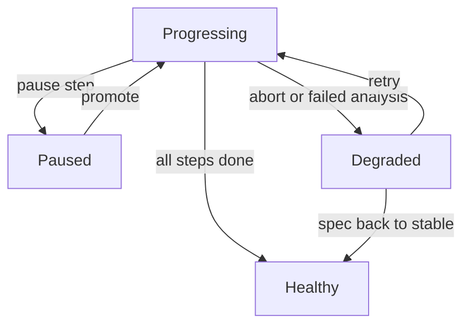

# Reading Status And Controlling A Release

A release can be stopped halfway, resumed, aborted or retried. To work safely, you must be able to tell from the status which of these states a `Rollout` is in. This part shows the four phases, what pauses a release, and the commands that change the state.

## The four phases

The field `status.phase` summarises the `Rollout`. The controller sets it after every reconcile:

- `Progressing`: the controller is moving replicas toward the desired state, or it is waiting for pods to become ready.
- `Paused`: the controller has stopped on purpose. A pause step, a blue-green wait for promotion, or `spec.paused: true` causes it.
- `Healthy`: the current revision is stable, all replicas are available and no release is in progress.
- `Degraded`: the release cannot finish. A common cause is an abort after a failed analysis, or a pod that never becomes ready before `progressDeadlineSeconds` (default 600 seconds) passes.

The field `status.message` gives a short reason, and `status.conditions` lists the details. The condition `Progressing` tells whether the controller still makes progress, the condition `Available` tells whether the minimum number of pods is available, and the condition `Paused` tells whether the release is paused.

<!-- astrona:playground:renew -->

Read the phase and the message of any `Rollout` in the namespace:

```sh
kubectl -n starfleet get rollouts
kubectl -n starfleet get rollout <NAME> -o jsonpath='{.status.phase}{"\n"}{.status.message}{"\n"}'
```

Replace `<NAME>` with the name of a Rollout that exists in the playground.

## What causes a pause

There are three sources of a pause. A canary step `pause: {}` pauses with no end time. A step `pause: {duration: 5m}` pauses for that long and then continues alone. A blue-green `Rollout` with `autoPromotionEnabled: false` pauses after the new ReplicaSet is ready, and waits for a promotion.

The controller records each pause in `status.pauseConditions`. Each entry has a `reason` (such as `CanaryPauseStep` or `BlueGreenPause`) and a start time. Removing the entry, which is what a promotion does, lets the release continue. The field `spec.paused` is separate: it is a manual stop that an operator sets and clears.

A paused release is not a failed release. The pods of both revisions keep running while the controller waits.

## Commands that control a release

The Argo Rollouts plugin for `kubectl` is a separate program, installed on the operator's computer. It is not installed in the playground, and this course never needs it for a task. Its commands are worth knowing for the exam:

- `kubectl argo rollouts get rollout <name> --watch` shows a tree of the Rollout, ReplicaSets, pods and AnalysisRuns, and updates it live.
- `kubectl argo rollouts status <name>` waits until the Rollout is healthy or degraded and exits with a matching exit code.
- `kubectl argo rollouts promote <name>` ends the current pause and moves to the next step. With `--full` it skips all remaining steps and analysis.
- `kubectl argo rollouts abort <name>` stops the release and returns to the stable revision.
- `kubectl argo rollouts retry rollout <name>` restarts an aborted release.
- `kubectl argo rollouts undo <name>` rolls back to the previous revision (or to the revision given with `--to-revision`).
- `kubectl argo rollouts set image <name> <container>=<image>` changes the image and so starts a release.
- `kubectl argo rollouts restart <name>` restarts the pods.
- `kubectl argo rollouts dashboard` starts a local web page that shows all Rollouts.

Each command patches the `Rollout` object. A promotion clears the pause conditions in the status. An abort sets `status.abort` to `true`. Every action is an API change to the same object that the controller watches, so you can do the same with `kubectl patch` when the plugin is not installed.

## What abort does

An abort tells the controller to stop the current release and go back to the stable ReplicaSet. In a canary the controller scales the new ReplicaSet down and moves the weight back to the stable one. In a blue-green rollout the active Service never moved, so the controller scales the new ReplicaSet down after a delay (`abortScaleDownDelaySeconds`, default 30).

After an abort, the phase is `Degraded` and the `currentPodHash` still points at the failed revision. The controller does not start the failed revision again by itself, because the spec still contains it. There are two ways out. You can change the spec back to the stable template, which makes `currentPodHash` equal `stableRS` again. Or you can run `retry` after you fix the cause, which starts the same revision again.



The diagram shows the four phases and the actions that move a `Rollout` from one to another.

## Undo is a template change

`undo` has no special mechanism. It reads the pod template of an earlier revision and writes it into the `Rollout` spec. The controller then sees a template whose hash already has a ReplicaSet and starts a normal release toward it. The release follows the same strategy and the same steps as any other release, unless the old revision is inside `rollbackWindow`, where the controller skips the analysis.

## Pausing by hand

The field `spec.paused` shows how a control action is only an object change. Setting it to `true` stops the controller at the current point. Pods that already run keep running, and the controller starts no new step. Setting it back to `false` lets the release continue.

Pause a Rollout from the playground, check that the phase changes, and resume it. Replace `<NAME>` with the name of a Rollout:

```sh
kubectl -n starfleet patch rollout <NAME> --type merge -p '{"spec":{"paused":true}}'
kubectl -n starfleet get rollout <NAME> -o jsonpath='{.status.phase}{"\n"}'
kubectl -n starfleet patch rollout <NAME> --type merge -p '{"spec":{"paused":false}}'
```

A paused `Rollout` that is already `Healthy` shows no change, because there is no release to stop. Start a release first (change the pod template), and pause during it, to see the phase `Paused`.

## Reading the counters during a release

The counters in `status` change during a release, and they tell you how far it has come. `replicas` is the total number of pods in all ReplicaSets of the `Rollout`. `updatedReplicas` is the number of pods of the current revision. `readyReplicas` is the number of pods whose readiness check passes, and `availableReplicas` is the number that have been ready for at least `minReadySeconds`.

A release with 4 replicas and `maxSurge: 1` can show `replicas: 5` while the new pods start. A release that is stuck often shows `updatedReplicas` higher than `readyReplicas`. That pattern means the new pods exist but never pass the readiness check, and the cause is in the pod events, not in the Rollout.

## Common pitfalls

> [!WARNING]
> Do not read `Degraded` as a crash. It often means a deliberate abort. Read `status.message` and `status.abort` before you retry, because a retry without a fix repeats the same failure.
