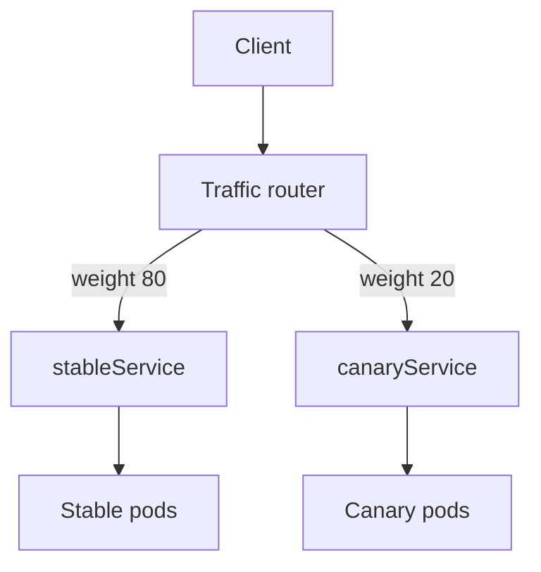

# Migrating A Deployment And Routing Traffic

Most teams start with Deployments. This part shows the two ways to move a workload to Argo Rollouts without downtime, and explains what a traffic router adds on top of plain Kubernetes Services.

## Migration option 1: convert the object

The first option changes the kind. You take the Deployment manifest, change `apiVersion` to `argoproj.io/v1alpha1` and `kind` to `Rollout`, and replace `spec.strategy` with `canary` or `blueGreen`. Everything else (replicas, selector, template) stays. Then you delete the Deployment with `--cascade=orphan`, which removes the Deployment but leaves its pods. The pods keep serving. The Rollout then adopts them or replaces them, depending on the labels.

This option is the cleanest end state. It needs care with the order of steps, because two controllers that select the same pods can fight over them.

## Migration option 2: workloadRef

The second option leaves the Deployment in place. A `Rollout` has a field `workloadRef` that names a Deployment. The Rollout reads the pod template and the selector from that Deployment, so no template is copied. The field cannot be combined with `spec.template`.

Save this as `rollout-fleet.yaml`. It references a Deployment named `fleet` that must exist in `starfleet`:

```yaml
apiVersion: argoproj.io/v1alpha1
kind: Rollout
metadata:
  name: fleet-rollout
  namespace: starfleet
spec:
  replicas: 2
  workloadRef:
    apiVersion: apps/v1
    kind: Deployment
    name: fleet
    scaleDown: onsuccess
  strategy:
    canary: {}
```

The file only works when the Deployment `fleet` exists, so this part does not apply it. The playground exercise for this module does the same with a Deployment that it creates.

The field `scaleDown` decides what happens to the Deployment's own pods:

- `never`: the Deployment is not scaled down. Two sets of pods run, and a Service that selects both sends traffic to both.
- `onsuccess`: the controller scales the Deployment to 0 after the Rollout is healthy.
- `progressively`: the controller scales the Deployment down as the Rollout scales up.

If the Rollout fails, the controller scales the Deployment back up. The pod template then stays in one place, the Deployment, and a change to that template starts a release of the Rollout. This is useful for tools that generate Deployments, such as Helm charts.

<!-- astrona:playground:renew -->

To see the field in the schema of the installed CRD:

```sh
kubectl explain rollout.spec.workloadRef
```

## Services and traffic

A Kubernetes Service selects pods with labels and sends each request to one of the ready pods. The Service has no notion of weights. With a plain Service, the share of requests that a revision gets depends on how many of its pods exist. A canary with 1 pod beside 4 stable pods gets about 20 percent of the connections, but the number is only approximate. Clients that keep connections open, retries and caching change the real split.

A traffic router is a component that can split requests by exact weight, header or path: a service mesh or an ingress controller. Argo Rollouts supports these through `spec.strategy.canary.trafficRouting`: Istio, NGINX Ingress, AWS Application Load Balancer, Service Mesh Interface (SMI), Ambassador, Apache APISIX, Traefik and, through a plugin, the Kubernetes Gateway API. The controller does not forward requests. It edits the routing objects of the router, such as the weights of an Istio `VirtualService`, and the router sends the requests.

With a router, the Rollout uses two Services: `stableService` and `canaryService`. The controller adds the `rollouts-pod-template-hash` selector to each, so each Service selects only the pods of one revision.



The diagram shows that the router applies the weights, and the two Services only select pods.

## Argo CD and Git ownership

Argo CD can manage a `Rollout` from Git. Argo CD owns the desired spec; the Rollouts controller owns the progress. Argo CD reports a `Rollout` as healthy or degraded by reading the same `status.phase`. Do not edit the `Rollout` by hand when Argo CD manages it, because Argo CD restores the Git version. Promote, abort and retry only change status fields and are not reverted.

## Checking that a migration worked

A migration has three results to verify, and each one uses a different object. First, the `Rollout` is `Healthy` and `readyReplicas` equals the wanted replicas. Second, the Service has the expected number of endpoints, which shows that the new pods receive requests. Third, the old Deployment has the replicas that the `scaleDown` mode promises.

Run the three checks for a migrated workload. Replace `<DEPLOYMENT>`, `<ROLLOUT>` and `<SERVICE>` with the names in your cluster:

```sh
kubectl -n starfleet get rollout <ROLLOUT> -o jsonpath='{.status.phase} {.status.readyReplicas}{"\n"}'
kubectl -n starfleet get endpoints <SERVICE>
kubectl -n starfleet get deployment <DEPLOYMENT> -o jsonpath='{.spec.replicas}{"\n"}'
```

A mismatch points to a specific cause. A healthy `Rollout` with too few endpoints means the Service selector does not match the pod labels. A healthy `Rollout` with a Deployment that still has replicas means `scaleDown` is `never`, or the `Rollout` has not become healthy yet.

## Common pitfalls

> [!WARNING]
> With `scaleDown: never`, the Deployment keeps its pods and doubles the capacity in use. Do not also set `spec.template` next to `workloadRef`. A Service that selects only `app` sends requests to the pods of both workloads until the Deployment is scaled down.
