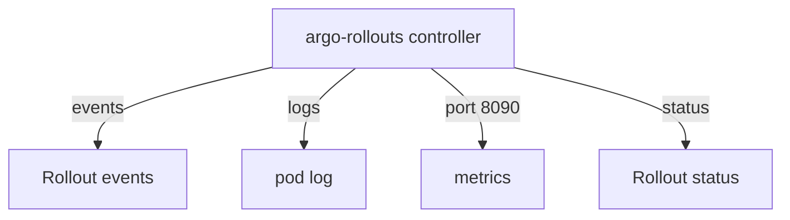

# Observing A Release: Events, Logs And Metrics

The `status` of a `Rollout` tells what the state is, but it does not tell what the controller did to reach it. When a release is slow or stuck, an operator needs the history of the actions. The controller leaves that history in three places: Kubernetes events, its own logs and its metrics endpoint. This part shows where each one is and what it answers.

## Events on the Rollout

The controller records an event on the `Rollout` object each time it does something noteworthy, for example when it scales a ReplicaSet or when a step starts. Kubernetes stores events for a short time, so read them while the release is running. The command `kubectl describe` prints them at the end of its output.

Read the events of the playground `Rollout`:

<!-- astrona:playground:renew -->

```sh
kubectl -n starfleet describe rollout crew-rollout
kubectl -n starfleet get events --field-selector involvedObject.name=crew-rollout
```

The second command lists only the events whose subject is the `Rollout`. Events of the ReplicaSets and pods have other subjects, so run the same command with their names to see them.

## The controller log

The controller is a pod in the `argo-rollouts` namespace. It writes one structured log line for each action, with the namespace and the name of the `Rollout` in the line. The log shows reconcile details that events do not show, such as why the controller chose a replica count.

Read the last lines and filter for one `Rollout`:

```sh
kubectl -n argo-rollouts logs deployment/argo-rollouts --tail=100
kubectl -n argo-rollouts logs deployment/argo-rollouts --tail=500 | grep crew-rollout
```

The log is the place to look when the `Rollout` status shows no useful message. An error in a Service update or in a traffic router change appears here first.

## Controller metrics

The controller serves Prometheus metrics on port 8090. Prometheus is a monitoring system that reads a text page of metrics from an address on a schedule. The metrics describe every `Rollout`, for example `rollout_info` (one series for each `Rollout`, with labels such as the strategy and the phase) and `rollout_reconcile` (how long each reconcile takes). The controller also exports metrics for analysis runs, for example `analysis_run_info`.

Forward the port to your computer and read the page:

```sh
kubectl -n argo-rollouts port-forward deployment/argo-rollouts 8090:8090
```

In a second terminal:

```sh
curl -s http://127.0.0.1:8090/metrics | grep rollout_info
```

A dashboard or an alert rule can use these series to show how many `Rollout` objects are `Degraded`. The controller also serves a health check on port 8080, which the cluster uses to decide whether the controller pod is ready.



The diagram shows the four outputs of the controller that an operator can read.

## Choosing where to look

Use the status for the current state. Use events for the last few actions on one object. Use the log for the reason behind an action or an error. Use the metrics for trends across many `Rollout` objects. The sources agree, because they all come from the same reconcile loop.

You now know where the controller records its work. The next question is what an operator does when the work fails and the release does not finish.

## Common pitfalls

> [!WARNING]
> Events expire after about an hour, so an old failure may have no events left. Read the controller log with `--tail` and a filter, because the log covers every `Rollout` in the cluster. The metrics endpoint is not exposed outside the pod, so a `port-forward` or a monitoring scrape configuration is needed to read it.
