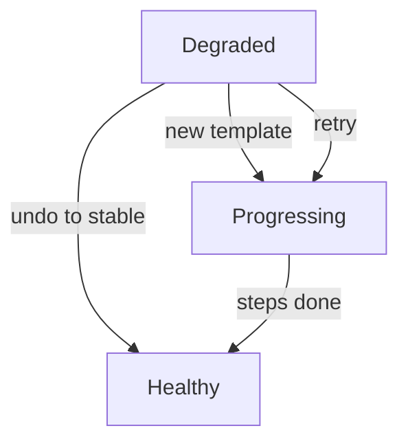

# Failed Releases And Recovery

A release can fail in three ways: the spec is not valid, the new pods never become ready, or an abort stops the release. Each way leaves a different trace in the status, and each has a different way out. This part names the traces and the recovery steps so that an operator can decide quickly.

## An invalid spec

The controller validates a `Rollout` each time it reconciles. When the spec breaks a rule, for example a `Rollout` with both `canary` and `blueGreen`, or a blue-green strategy without `activeService`, the controller sets the condition `InvalidSpec` to `True`, puts the reason in the condition message and makes no change to the ReplicaSets. The API server accepted the object, because the schema allows it. The controller rejects it in its own check.

Read the conditions of a `Rollout`:

<!-- astrona:playground:renew -->

```sh
kubectl -n starfleet get rollout crew-rollout -o jsonpath='{range .status.conditions[*]}{.type}={.status} {.reason}{"\n"}{end}'
```

A healthy `Rollout` shows `Available=True` and `Progressing=True`. An invalid one adds `InvalidSpec`. The fix is to correct the spec; the controller picks up the change and the condition clears.

## Pods that never become ready

When a new revision starts and its pods fail their readiness check, `updatedReplicas` stays higher than `readyReplicas`. The controller keeps waiting. After `progressDeadlineSeconds` the condition `Progressing` becomes `False` with the reason `ProgressDeadlineExceeded`, and the phase becomes `Degraded`. The stable ReplicaSet keeps serving the whole time, because the strategy never removed it.

To find the cause, look at the pods, not at the `Rollout`:

```sh
kubectl -n starfleet get pods -l app=crew
kubectl -n starfleet describe pod <POD_NAME>
```

Replace `<POD_NAME>` with a pod that is not ready. The events of the pod name the cause, for example an image that cannot be pulled or a readiness probe that fails.

## Recovery paths

There are three ways to leave a `Degraded` state, and the right one depends on the cause.

- Fix the pod template. A new template creates a new revision and a new release. This is the usual path when the image or the probe was wrong.
- Return to the stable template. If the spec matches the stable ReplicaSet again, `currentPodHash` equals `stableRS` and the phase returns to `Healthy`. An undo does this.
- Retry. If the cause was outside the `Rollout`, for example a registry that was down, fix the cause and retry the same revision. The plugin command `kubectl argo rollouts retry rollout` clears the abort flag in the status, and the controller starts the release again.



The diagram shows that a degraded `Rollout` returns to work through a new template, an undo or a retry.

## Restarting pods without a release

Sometimes the pods need a restart but the template is correct, for example to load a changed ConfigMap value. The field `spec.restartAt` makes the controller replace the pods one by one with no new revision. The plugin command `kubectl argo rollouts restart` sets it. Use it instead of a change to a template label, which would start a full release.

## What you know now

An invalid spec shows in the condition `InvalidSpec`, stuck pods show in `ProgressDeadlineExceeded`, and the stable ReplicaSet keeps serving in both cases. The way out is a corrected template, an undo, a retry or a restart. The next section moves from operating a `Rollout` to the strategies that the controller runs.

## Common pitfalls

> [!WARNING]
> A `Degraded` phase does not mean the application is down. The stable ReplicaSet may still serve all traffic, so check the endpoints of the Service before you react. Do not delete the `Rollout` to recover: that removes the ReplicaSets and the history together.
