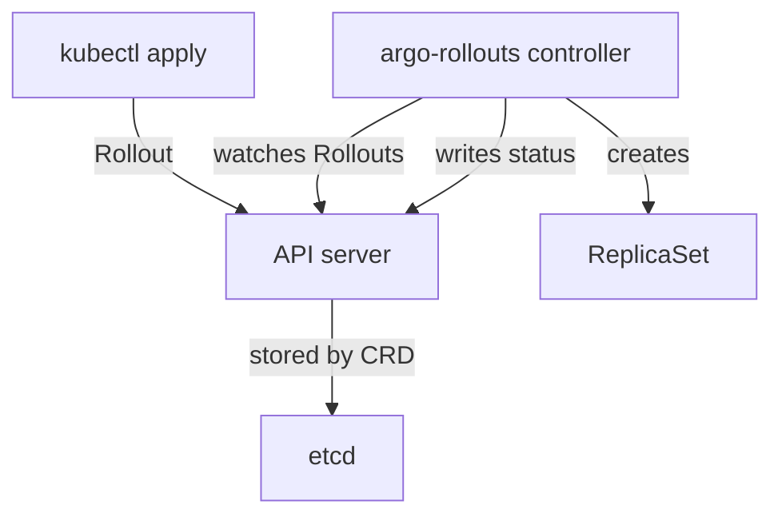

# Installing The Controller And The Custom Resources

A Kubernetes cluster does not know the kind `Rollout`. The cluster learns it from a custom resource definition (CRD), which is an object that adds a new resource kind to the Kubernetes API. A controller then watches the new kind and does the work. This part lists what the Argo Rollouts installation puts in the cluster and shows how to check each piece.

## What the installation creates

The Argo Rollouts project publishes one manifest, `install.yaml`, with every object the controller needs. The manifest is applied to a namespace called `argo-rollouts`, which the administrator creates first. The manifest contains these groups of objects:

- Five CRDs: `rollouts.argoproj.io`, `analysistemplates.argoproj.io`, `clusteranalysistemplates.argoproj.io`, `analysisruns.argoproj.io` and `experiments.argoproj.io`.
- A Deployment named `argo-rollouts` that runs the controller.
- A ServiceAccount, a ClusterRole and a ClusterRoleBinding. The ClusterRole lets the controller read and change Rollouts, ReplicaSets, Services, Ingresses, pods, Jobs, events and the router objects it supports.
- A Service named `argo-rollouts-metrics` that exposes the metrics port 8090 of the controller.
- A ConfigMap named `argo-rollouts-config` for controller settings, a ConfigMap named `argo-rollouts-notification-configmap` and a Secret named `argo-rollouts-notification-secret` for notifications.
- Aggregated ClusterRoles named `argo-rollouts-aggregate-to-admin`, `argo-rollouts-aggregate-to-edit` and `argo-rollouts-aggregate-to-view`. They add permissions on the Rollouts kinds to the built-in `admin`, `edit` and `view` roles, so a user with `edit` on a namespace can edit a `Rollout` there.

The controller is one pod. It does not serve user requests, and the applications keep running if the controller stops. A stopped controller only means that no new release steps happen.

## Installing the controller

The standard installation has two commands. The first creates the namespace and the second applies the manifest. The CRDs are large, so apply the manifest with server-side apply, which stores the field ownership on the server and does not write the whole object into an annotation.

Create the namespace and apply the manifest:

```sh
kubectl create namespace argo-rollouts
kubectl apply --server-side -n argo-rollouts -f https://github.com/argoproj/argo-rollouts/releases/latest/download/install.yaml
```

For a repeatable installation, pin a version instead of `latest`, for example `releases/download/v1.10.0/install.yaml`. The playground already did this, so do not run the commands again. The Helm chart `argo/argo-rollouts` installs the same objects and lets you set the options in a values file.

## Checking the installation

<!-- astrona:playground:renew -->

A healthy installation has the CRDs registered and the controller Deployment available. List the CRDs of the Argo project and the objects in the namespace:

```sh
kubectl get crd | grep argoproj.io
kubectl -n argo-rollouts get deployment,service,configmap,secret
```

The first command shows the five CRDs. The second shows the Deployment with one ready pod, the metrics Service and the configuration objects.

The CRD also serves as the documentation of the kind. The command `kubectl explain` reads the schema from the CRD:

```sh
kubectl explain rollout.spec.strategy
kubectl api-resources --api-group=argoproj.io
```

The second command lists the short names of the kinds, for example `ro` for `rollouts`. A short name saves typing in `kubectl get ro`.

## What happens without the controller

The CRD alone is enough for the API server to accept a `Rollout`. The object is stored and can be read with `kubectl get rollout`. Nothing creates the ReplicaSet and nothing sets `status.phase`, because the controller does that work. A `Rollout` that stays without any status is the first sign that the controller is missing or not running.



The diagram shows that the API server only stores the `Rollout`, and the controller creates the ReplicaSet and writes the status.

## What you know now

The installation is one manifest with five CRDs, one controller Deployment, role-based access control (RBAC) objects, a metrics Service and configuration objects. The CRDs make the API accept the kinds, and the controller makes them work. The next question is how to change the way the controller behaves.

## Common pitfalls

> [!WARNING]
> Deleting a CRD deletes every object of that kind in the cluster. Never delete the `rollouts.argoproj.io` CRD to "reinstall" the controller. Also, applying the manifest to a namespace other than `argo-rollouts` works only if you change the namespace in the ClusterRoleBinding; the standard manifest assumes `argo-rollouts`.
