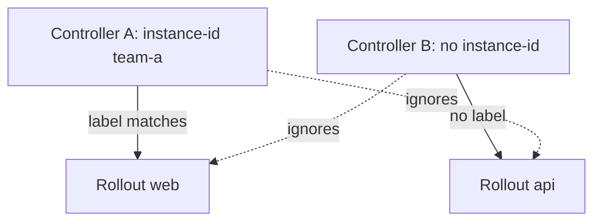

# Controller Options And Installation Scope

The default installation works for one team in one cluster. Real clusters need more: a different log level to find a fault, a controller that sees only some namespaces, or two controllers that must not touch the same `Rollout`. This part shows the options that control this behaviour and how to change them.

## Command-line options of the controller

The controller is the container `argo-rollouts` in the Deployment `argo-rollouts`. Its behaviour changes through command-line arguments in the container `args` field. These options are the ones to know:

- `--loglevel`: the log level, one of `debug`, `info`, `warn` and `error`. The default is `info`.
- `--logformat`: the log format, `text` or `json`. A log collector parses `json` more easily.
- `--instance-id`: an identifier string. The controller then manages only the Rollouts that carry the label `argo-rollouts.argoproj.io/controller-instance-id` with the same value.
- `--namespaced`: the controller watches only its own namespace.
- `--leader-elect`: with several controller replicas, only the leader works, and the others wait.
- `--metricsport` and `--healthzPort`: the ports of the metrics and health endpoints. The metrics port is 8090 by default.

Each option is two arguments in the list, the name and the value, or one argument with an equals sign.

## Changing the log level

The playground controller runs with the defaults. A strategic merge patch is a patch file that Kubernetes merges into the object, and for a list of containers it matches entries by `name`. Use one to add arguments to the container.

Save this as `controller-args.yaml`:

```yaml
spec:
  template:
    spec:
      containers:
      - name: argo-rollouts
        args:
        - --loglevel
        - debug
```

<!-- astrona:playground:renew -->

Apply it:

```sh
kubectl -n argo-rollouts patch deployment argo-rollouts --patch-file controller-args.yaml
```

Then check the result. The Deployment starts a new pod with the new arguments, and the old pod stops:

```sh
kubectl -n argo-rollouts rollout status deployment/argo-rollouts
kubectl -n argo-rollouts get deployment argo-rollouts -o jsonpath='{.spec.template.spec.containers[0].args}{"\n"}'
kubectl -n argo-rollouts logs deployment/argo-rollouts --tail=20
```

The log now contains lines with `level=debug`. A debug log is large, so return to `info` after the investigation.

## Cluster-wide and namespace-scoped installation

The standard `install.yaml` is cluster-wide. It uses a ClusterRole, so the controller reads and changes `Rollouts` in every namespace. The project also publishes `namespace-install.yaml`. It uses a Role and a RoleBinding in one namespace, and it starts the controller with `--namespaced`. Use it when the team has no right to create cluster-wide objects. The CRDs are cluster-wide objects in both cases, so an administrator must install them once.

## Instance identifiers

Two controllers in one cluster would both act on the same `Rollout` and fight over the ReplicaSets. The option `--instance-id` solves this. A controller started with `--instance-id=team-a` manages only the Rollouts with the label `argo-rollouts.argoproj.io/controller-instance-id: team-a`. A controller without an instance identifier manages only the Rollouts that have no such label.



The diagram shows that each controller manages only the Rollouts that match its identifier.

## What you know now

The controller options live in the container arguments, and a patch changes them. The scope of the installation and the instance identifier decide which Rollouts a controller manages. The next question is how a person talks to a running release.

## Common pitfalls

> [!WARNING]
> A patch that replaces the whole `args` list removes options set earlier, such as `--namespaced`. Read the current arguments first. A Rollout with an instance label that no controller uses is never reconciled, and it has no status.
