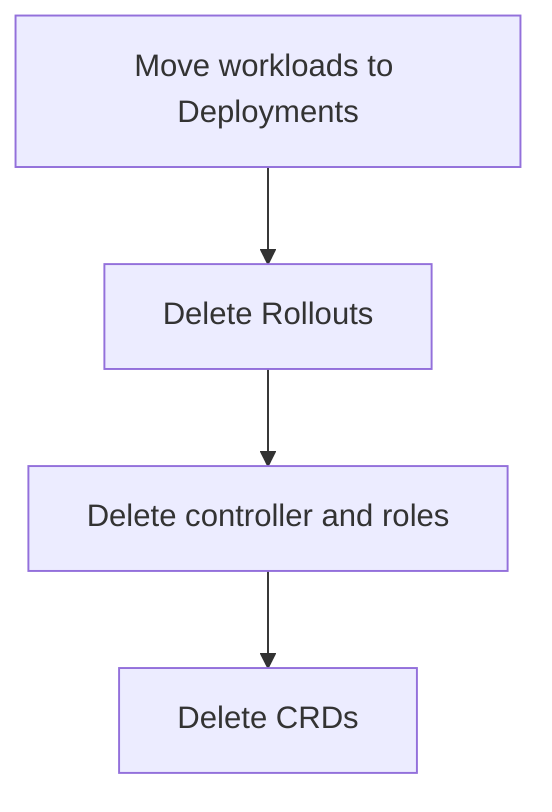

# The Dashboard, Upgrades And Removal

Two jobs remain after the controller runs. People want to watch releases in a browser, and administrators must keep the controller current and sometimes remove it. This part covers the dashboard, the upgrade and the safe removal of Argo Rollouts.

## The dashboard

The plugin command `kubectl argo rollouts dashboard` starts a small web server on the local machine. By default it listens on port 3100, and a browser opens `http://localhost:3100`. The dashboard lists the Rollouts of a namespace as cards. Each card shows the strategy, the steps, the ReplicaSets with their images, and buttons to promote, abort, retry and restart. It uses the kubeconfig of the person who started it, so it can do only what that person is allowed to do.

The dashboard is a tool for the local machine. It is not a service in the cluster, and it keeps no data of its own. Every view comes from the Kubernetes API. If a team wants a shared view, a tool such as Argo CD shows `Rollouts` in its own interface.

## Upgrading

The controller is stateless. All state is in the `Rollout` objects, so an upgrade replaces the controller Deployment and changes the CRDs. The usual steps are:

1. Read the release notes for the new version, because a field can be deprecated.
2. Apply the new `install.yaml` with server-side apply. This updates the CRDs, the ClusterRole and the Deployment together.
3. Wait for the Deployment to be available.
4. Check that the Rollouts still show a status and that the observed generation matches the generation.

Running pods do not restart. A `Rollout` in the middle of a release continues after the new controller starts, because the status holds the step and the revision. The server-side apply command is the same as for the installation:

<!-- astrona:playground:renew -->

```sh
kubectl -n argo-rollouts get deployment argo-rollouts -o jsonpath='{.spec.template.spec.containers[0].image}{"\n"}'
kubectl -n starfleet get rollout mission -o jsonpath='{.metadata.generation} {.status.observedGeneration}{"\n"}'
```

The first command prints the image, which includes the controller version. The second prints two numbers. When they are equal, the controller has read the latest spec.

## Removing the controller

Removal has an order, because deleting a CRD deletes all objects of its kind. First decide what happens to the workloads. The pods of a `Rollout` belong to ReplicaSets owned by the Rollout, so deleting the Rollout deletes them. To keep an application running without Argo Rollouts, convert the `Rollout` to a Deployment first, or use a Deployment that the Rollout references with `workloadRef` and scale it back up.

After the workloads are safe, delete the Rollouts, then the controller Deployment and its roles, and last the CRDs.



The diagram shows the order, with the CRDs last.

## What you know now

The dashboard is a local view built on the Kubernetes API. An upgrade applies the new manifest, and the status of running releases carries over. Removal starts with the workloads and ends with the CRDs. This module has now covered the objects, the options, the plugin and the lifecycle of the controller.

## Common pitfalls

> [!WARNING]
> Starting the dashboard on a shared server without protection lets anyone who reaches the port use the permissions of the starting user. Deleting the CRDs before the Rollouts removes every Rollout and its pods at once.
