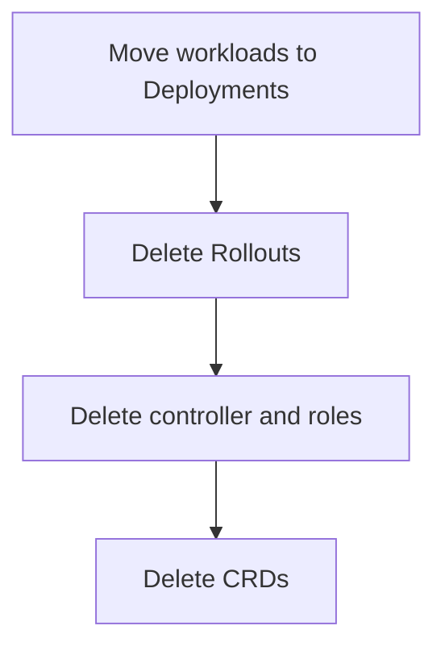

# The Dashboard, Upgrades And Removal

Two jobs remain after the controller runs. People want to watch releases in a browser, and administrators must keep the controller current and sometimes remove it. All three tasks touch the same objects: the controller Deployment, the Custom Resource Definitions (CRDs) and the `Rollout` objects that hold the state of every release. This part explains what the dashboard does underneath, what an upgrade changes and in which order a removal must happen so that no application stops by accident.

## What the dashboard is

The plugin command `kubectl argo rollouts dashboard` starts a small web server on the local machine. By default it listens on port 3100, and a browser opens `http://localhost:3100`. The web pages are built into the plugin binary, so the command needs no download and no object in the cluster. The dashboard lists the Rollouts of a namespace as cards. Each card shows the strategy, the steps, the ReplicaSets with their images, and buttons to promote, abort, retry and restart.

Underneath, the dashboard is the plugin with a web page in front of it. It reads the `Rollout`, `ReplicaSet` and `AnalysisRun` objects through the Kubernetes API, with the kubeconfig of the person who started it. A button does what the matching plugin command does: it writes the same field of the `Rollout`. The abort button sets `status.abort` to `true`, the restart button sets `spec.restartAt` to the current time, and the promote button clears the pause so the controller moves to the next step. The controller never hears from the dashboard directly. It sees the changed field on its next reconcile and acts on it.

Because the dashboard uses the kubeconfig of the person who started it, it can do only what that person is allowed to do. A read-only ClusterRole makes every button fail with a permission error from the API server. The dashboard keeps no data of its own. If a team wants a shared view, a tool such as Argo CD shows Rollouts in its own interface.

The plugin is not installed in the playground, so the dashboard cannot be started there. The commands below read the same objects that the dashboard would read, so you see what it builds its cards from.

## Upgrading

The controller is stateless. All state is in the `Rollout` objects: the current step is in `status.currentStepIndex`, the revision in `status.currentPodHash`, and a pause in `status.pauseConditions`. An upgrade therefore replaces the controller Deployment and updates the CRDs, and nothing else. The usual steps are:

1. Read the release notes for the new version, because a field can be deprecated or a default can change.
2. Apply the new `install.yaml` with server-side apply. This updates the CRDs, the ClusterRole and the Deployment together.
3. Wait for the Deployment to be available.
4. Check that the Rollouts still show a status and that the observed generation matches the generation.

The CRD update matters most. A CRD holds the schema that the API server uses to validate a `Rollout`. A new controller version can read a new field only after the new CRD is in place. Server-side apply updates the schema in place, and existing objects keep their stored data. Pods of the applications do not restart, because the ReplicaSets and pods are not part of the upgrade.

The Deployment update is a normal rolling update. For a moment, the old and the new controller pod exist at the same time. The controller uses leader election, so only the pod that holds the lease reconciles, and no two controllers write the same `Rollout`. A `Rollout` in the middle of a release continues after the new controller starts, because the new controller reads the step and the revision from the status and carries on from there.

<!-- astrona:playground:renew -->

Read the version that runs in the playground. The image tag of the controller Deployment carries the version:

```sh
kubectl -n argo-rollouts get deployment argo-rollouts -o jsonpath='{.spec.template.spec.containers[0].image}{"\n"}'
kubectl get crd rollouts.argoproj.io -o jsonpath='{.spec.versions[*].name}{"\n"}'
```

The first command prints the image, which ends in `v1.10.0`. The second prints the API version that the `Rollout` CRD serves, `v1alpha1`. An upgrade replaces the image and rewrites the schema under this API version; the version name itself has not changed between releases of the controller.

After the Deployment is available, check that the controller has read every `Rollout` with the new version. The field `metadata.generation` counts the changes to the spec, and the controller writes the generation it last processed into `status.observedGeneration`:

```sh
kubectl -n argo-rollouts rollout status deployment argo-rollouts --timeout=120s
kubectl -n starfleet get rollout mission -o jsonpath='{.metadata.generation} {.status.observedGeneration}{"\n"}'
```

The first command waits for the controller Deployment. The second prints two numbers. When they are equal, the controller has read the latest spec of `mission`. After an upgrade, a `Rollout` whose `observedGeneration` stays behind its `generation` is the first sign that the new controller does not process it, and the controller log then names the reason.

Version skew works in one direction. A newer CRD with an older controller is safe for a short time, because the old controller ignores fields it does not know. An older CRD with a newer controller is not safe, because the API server drops the fields the schema does not know, and the new controller then sees an incomplete spec. Apply the CRDs before or together with the Deployment, never after.

## Removing the controller

Removal has an order, because deleting a CRD deletes all objects of its kind. The pods of a `Rollout` belong to ReplicaSets that have an owner reference to the Rollout. Deleting the Rollout, by hand or through the CRD, makes the Kubernetes garbage collector delete the ReplicaSets, and the ReplicaSets delete their pods. The application stops.

First decide what happens to the workloads. There are three ways to keep an application running without Argo Rollouts:

- Create a Deployment with the same selector and pod template, wait for its pods to be ready, and then delete the `Rollout`. The Service selects pods of both for a moment, so no request is lost.
- For a `Rollout` that references a Deployment with `workloadRef`, scale the Deployment back up first. The Rollout created its own ReplicaSets from the Deployment template and scaled the Deployment to zero, so the Deployment pods must exist again before the Rollout goes.
- Delete the `Rollout` with `--cascade=orphan`. The ReplicaSets and pods stay without an owner. A Deployment with the same selector then adopts the orphaned ReplicaSets and rolls over to a ReplicaSet of its own.

After the workloads are safe, delete the Rollouts, then the controller Deployment and its roles, and last the CRDs.



The diagram shows the order, with the CRDs last.

The order of the last two steps matters too. If the CRDs go before the controller, the controller logs errors because the object kinds it watches no longer exist, but nothing breaks. If the controller goes before the Rollouts, the Rollouts stay as objects that nobody reconciles. Their pods keep running, because pods are managed by the ReplicaSets, but a promote or an abort does nothing until a controller exists again.

The CRDs of this version are `rollouts`, `analysistemplates`, `clusteranalysistemplates`, `analysisruns` and `experiments`, all in the group `argoproj.io`. Read the list before you delete it, so you know which object kinds disappear:

```sh
kubectl get crd -o name | grep argoproj.io
kubectl get rollouts --all-namespaces
```

The first command prints the five CRD names. The second prints every `Rollout` in the cluster, which is the list of applications that need a Deployment before the CRDs can go. In the playground this is only `mission` in `starfleet`.

## What you know now

The dashboard is the plugin with a web page in front of it. It reads the objects through the Kubernetes API with the kubeconfig of the person who started it, and its buttons write the same `Rollout` fields as the plugin commands. An upgrade applies the new manifest with server-side apply, the CRDs before or with the Deployment, and the status of a running release carries over, because the controller keeps no state of its own. Removal starts with the workloads and ends with the CRDs, because deleting a CRD deletes every object of its kind and the ReplicaSets and pods with it. This module has now covered the objects, the options, the plugin and the lifecycle of the controller.

## Common pitfalls

> [!WARNING]
> Starting the dashboard on a shared server without protection lets anyone who reaches the port use the permissions of the starting user. Applying a new controller Deployment before the new CRDs makes the API server drop the fields the old schema does not know. Deleting the CRDs before the Rollouts removes every Rollout and its pods at once.
