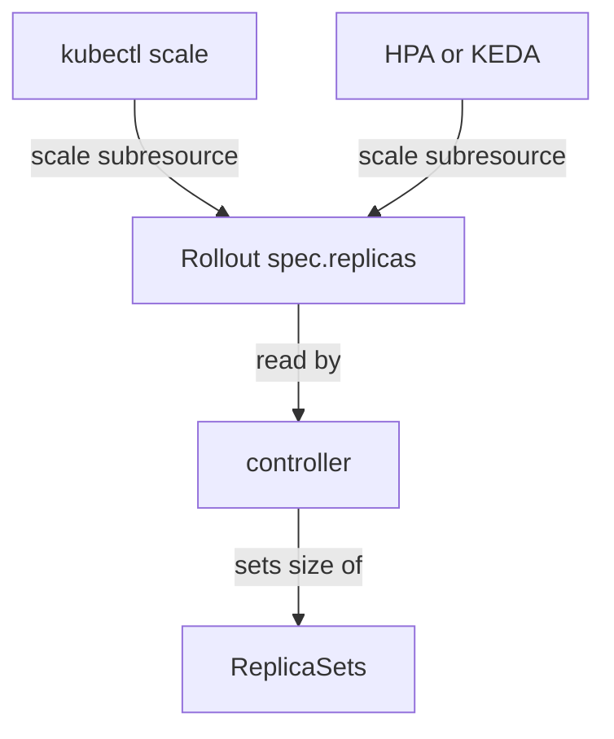

# The Scale Subresource And The Replica Count

Autoscalers and `kubectl scale` do not know the kind `Rollout`. They know one common interface, the scale subresource. This part explains that interface, shows which fields of a `Rollout` it uses, and shows what the controller does when the count changes.

## The scale subresource

A subresource is an extra endpoint of a resource, such as `/scale`. The scale subresource accepts and returns a small object with the desired replica count, the current replica count and a label selector. A custom resource definition declares where those values live in the object. The `Rollout` CRD declares `spec.replicas` for the desired count, `status.replicas` for the current count and `status.selector` for the label selector.

Any client that supports the scale subresource then works with a `Rollout` without special code. This includes `kubectl scale`, the HorizontalPodAutoscaler and KEDA, which is an event-driven autoscaler.

## Changing the count by hand

The field `spec.replicas` defaults to 1 when it is missing. In the playground, `mission` has two replicas. Raise it to three with `kubectl scale`:

<!-- astrona:playground:renew -->

```sh
kubectl -n starfleet scale rollout/mission --replicas=3
kubectl -n starfleet get rollout mission -o jsonpath='{.spec.replicas} {.status.replicas} {.status.selector}{"\n"}'
kubectl -n starfleet get replicasets -l app=mission
```

The first command writes `spec.replicas`. The second shows the desired count, the current count and the selector the controller reports. The third shows that the stable ReplicaSet now has three pods.

Return to two replicas, so the next exercises start from the same state:

```sh
kubectl -n starfleet scale rollout/mission --replicas=2
```

## What the controller does with the new count

The controller reads `spec.replicas` on every reconcile. A change of the count is not a new revision, because the pod template hash does not change. The controller scales the stable ReplicaSet to the new count and takes no step in the strategy.

When a release is in progress, the count is a target for the whole Rollout. The controller splits it between the stable and the canary ReplicaSets according to the strategy.



The diagram shows that every scaling client writes the same field and the controller sizes the ReplicaSets.

## Who owns the field

If an HPA manages a `Rollout`, the HPA writes `spec.replicas`. A manifest in Git that also sets `spec.replicas` will reset the count at every sync and fight the HPA. When an HPA is in use, remove `replicas` from the manifest, or tell the delivery tool to ignore that field.

## What you know now

The `Rollout` CRD maps the scale subresource to `spec.replicas`, `status.replicas` and `status.selector`. This lets `kubectl scale` and autoscalers work without special code. A count change is not a release. The next question is how an HPA uses this interface.

## Common pitfalls

> [!WARNING]
> Setting `spec.replicas` in a Git manifest while an HPA manages the `Rollout` makes the two writers overwrite each other. Scaling to zero stops the application. A scale change does not create a revision, so `kubectl rollout history`-style tools show nothing new.
