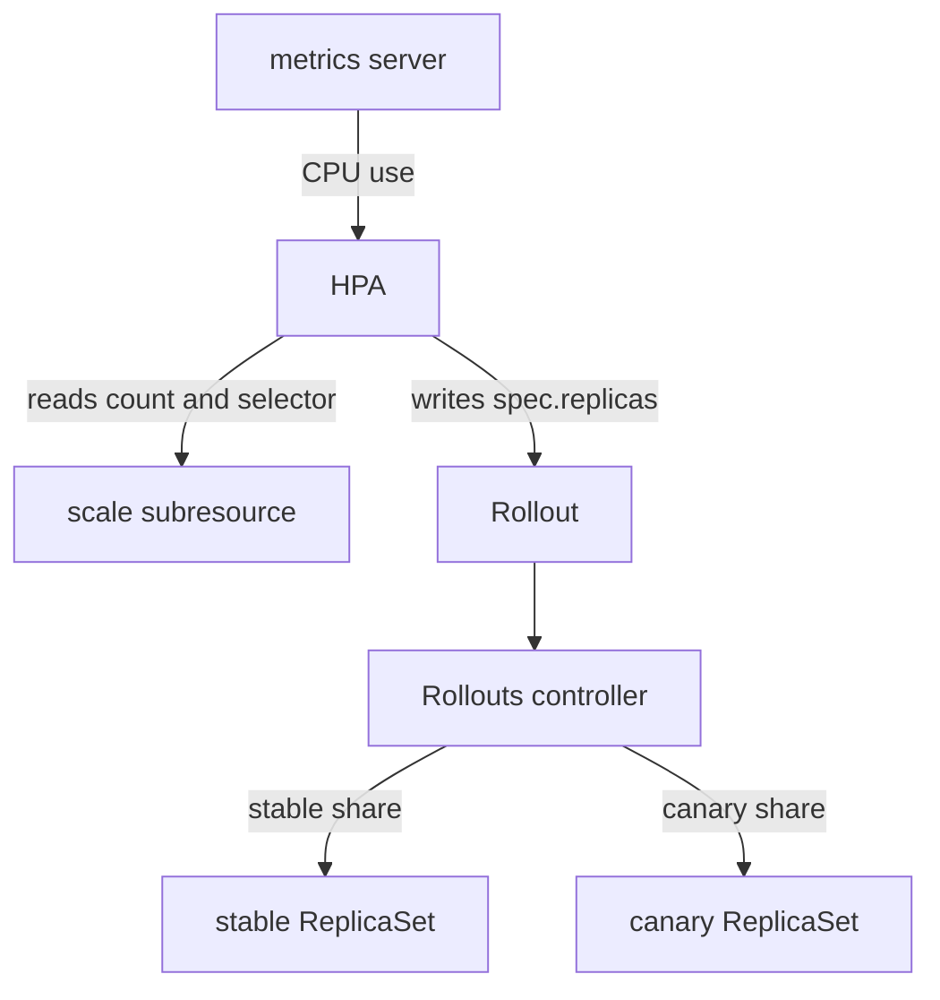

# An HPA That Targets A Rollout

A HorizontalPodAutoscaler (HPA) is a Kubernetes controller that changes the replica count of a workload to keep a metric near a target. A team that already uses an HPA with Deployments wants the same for a `Rollout`. This part shows the HPA manifest, what it needs to work and what each field means.

## The HPA manifest

The HPA finds its target through `scaleTargetRef`. For a `Rollout`, the reference names the API group and version of the Argo kind. The HPA then calls the scale subresource of that object.

Save this as `hpa-mission.yaml`:

```yaml
apiVersion: autoscaling/v2
kind: HorizontalPodAutoscaler
metadata:
  name: mission-hpa
  namespace: starfleet
spec:
  scaleTargetRef:
    apiVersion: argoproj.io/v1alpha1
    kind: Rollout
    name: mission
  minReplicas: 2
  maxReplicas: 5
  metrics:
  - type: Resource
    resource:
      name: cpu
      target:
        type: Utilization
        averageUtilization: 70
```

<!-- astrona:playground:renew -->

Apply it:

```sh
kubectl apply -f hpa-mission.yaml
```

Then check the result:

```sh
kubectl -n starfleet get hpa mission-hpa
kubectl -n starfleet describe hpa mission-hpa
```

The fields `minReplicas` and `maxReplicas` are the limits. The metric says: keep the average CPU use of the pods at 70 percent of their CPU request.

## What the HPA needs

The HPA needs two things that the `Rollout` does not provide. First, a metrics server in the cluster, which is the component that collects CPU and memory use from the kubelets and serves it through the Metrics API. Second, a CPU request on the containers, because `Utilization` is a percentage of the request. A container without a request gives the HPA nothing to divide by.

The playground has no metrics server. The HPA object is accepted, but its conditions report that it cannot read metrics, and it changes nothing. The `describe` output shows these conditions. This is a good habit when an HPA does not scale: read its conditions first.

## How the HPA and the Rollout work together

The HPA reads the current count and the selector from the scale subresource, calculates the desired count and writes `spec.replicas`. It does not know about canary steps or ReplicaSets. The selector in `status.selector` matches the pods of all ReplicaSets of the `Rollout`, so the HPA averages the metric over the stable and the canary pods together.

The controller then applies the count to the strategy. This split of work is the main point: the HPA decides how many pods in total, and the Rollouts controller decides how they are divided between versions.



The diagram shows the HPA writing one total and the controller dividing it between the ReplicaSets.

## Adding a CPU request

A pod template change creates a new revision. Adding a request is such a change. The field `resources.requests.cpu` under the container in the `Rollout` template is what makes `Utilization` meaningful, so teams add requests before they add an HPA.

Save this as `rollout-mission.yaml`. It is the playground `Rollout` with a CPU request of 100 millicores, one tenth of a CPU core:

```yaml
apiVersion: argoproj.io/v1alpha1
kind: Rollout
metadata:
  name: mission
  namespace: starfleet
spec:
  replicas: 2
  selector:
    matchLabels:
      app: mission
  template:
    metadata:
      labels:
        app: mission
    spec:
      containers:
      - name: mission
        image: docker.io/library/python:3.13-alpine
        env:
        - name: REVISION
          value: one
        ports:
        - containerPort: 8080
        resources:
          requests:
            cpu: 100m
        command:
        - python
        - -m
        - http.server
        - '8080'
  strategy:
    canary: {}
```

Apply it:

```sh
kubectl apply -f rollout-mission.yaml
```

Then check the result. The controller runs a normal release, because the template changed:

```sh
kubectl -n starfleet wait --for=jsonpath='{.status.phase}'=Healthy rollout/mission --timeout=240s
kubectl -n starfleet get rollout mission -o jsonpath='{.spec.template.spec.containers[0].resources.requests.cpu} {.metadata.annotations.rollout\.argoproj\.io/revision}{"\n"}'
```

The first value is `100m`. The revision annotation has gone up by one, which shows that the request is part of the pod template.

## What you know now

An HPA targets a `Rollout` with an `argoproj.io/v1alpha1` reference, needs a metrics server and CPU requests, and writes only the total replica count. The controller divides that count between the versions. The next question is what happens when the count changes during a release.

## Common pitfalls

> [!WARNING]
> Using `apiVersion: apps/v1` and `kind: Deployment` in `scaleTargetRef` for a `Rollout` makes the HPA look for a Deployment that does not exist. An HPA on a `Rollout` that is migrated with `workloadRef` should target the `Rollout`, not the referenced Deployment.
