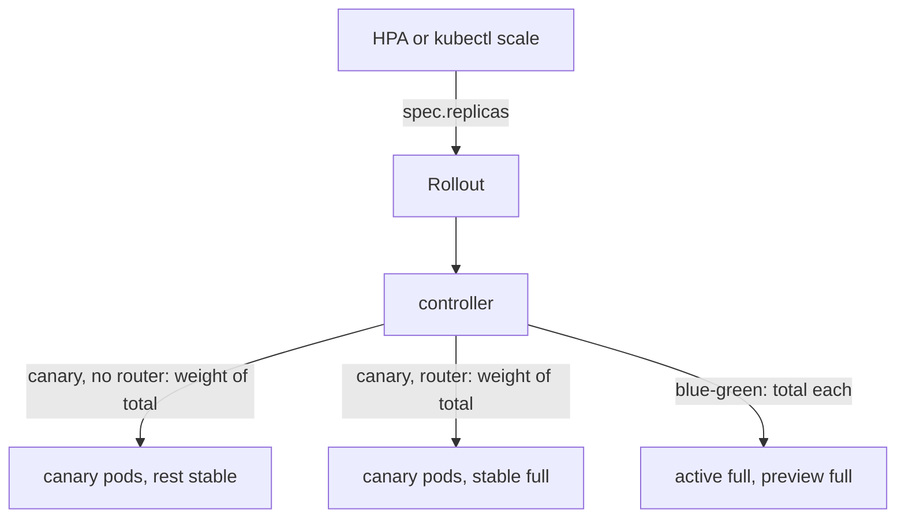

# Releases While The Replica Count Changes

Autoscaling and releases happen at the same time in a real cluster. A traffic peak can start a scale-up while a canary is at 20 percent, and a quiet night can shrink the count while a blue-green release waits for promotion. The field `spec.replicas` is one total, and the controller must divide it between the stable and the new ReplicaSet on every reconcile. This part shows the division for a canary without a traffic router, for a canary with one, and for blue-green, with worked numbers for each.

## A canary at 50 percent on a changing count

The playground `Rollout` `mission` has two replicas and no steps. Save this as `rollout-mission.yaml`. It raises the count to four, sets revision `two` and adds two steps, a weight of 50 and a pause without a duration:

```yaml
apiVersion: argoproj.io/v1alpha1
kind: Rollout
metadata:
  name: mission
  namespace: starfleet
spec:
  replicas: 4
  selector:
    matchLabels:
      app: mission
  template:
    metadata:
      labels:
        app: mission
    spec:
      containers:
      - name: mission
        image: docker.io/library/python:3.13-alpine
        env:
        - name: REVISION
          value: two
        ports:
        - containerPort: 8080
        command:
        - python
        - -m
        - http.server
        - '8080'
  strategy:
    canary:
      steps:
      - setWeight: 50
      - pause: {}
```

<!-- astrona:playground:renew -->

Apply it:

```sh
kubectl apply -f rollout-mission.yaml
```

Then check the result. The release stops at the pause, so the sizes stay readable:

```sh
kubectl -n starfleet wait --for=jsonpath='{.status.phase}'=Paused rollout/mission --timeout=180s
kubectl -n starfleet get replicasets -l app=mission -o custom-columns=NAME:.metadata.name,DESIRED:.spec.replicas,READY:.status.readyReplicas
```

The second command prints two ReplicaSets with two desired pods each. The canary has 50 percent of four, which is two, and the stable ReplicaSet has the remaining two.

Now change the total while the release waits. The `Rollout` has a scale subresource, so `kubectl scale` and a Horizontal Pod Autoscaler (HPA) can write `spec.replicas` without touching the rest of the spec:

```sh
kubectl -n starfleet scale rollout mission --replicas=8
kubectl -n starfleet get replicasets -l app=mission -o custom-columns=NAME:.metadata.name,DESIRED:.spec.replicas,READY:.status.readyReplicas
```

After a reconcile, each ReplicaSet has four desired pods. The weight stayed at 50 percent, the total became eight, and the controller recalculated the split. The pause is still in place, and the release does not move until a promotion. This is the behaviour the rest of the part explains.

## Canary without a traffic router

Without a router, a canary weight is turned into a number of pods, because the Service sends requests to pods in proportion to their number. The controller takes the weight as a percentage of `spec.replicas` and rounds up. The stable ReplicaSet gets the remaining pods. With 10 replicas and a weight of 20, the canary has 2 pods and the stable ReplicaSet has 8.

Rounding up changes small counts a lot. With 3 replicas and a weight of 50, the canary has 2 pods, which is 67 percent of the requests, and the stable ReplicaSet has 1. With 4 replicas and a weight of 10, the canary has 1 pod, which is 25 percent. The weight in the step is the lower bound of the share of pods, not its exact value.

The move from one split to the next respects `maxSurge` and `maxUnavailable`, which default to 25 percent each. With 10 replicas, `maxSurge` allows 3 extra pods, because surge rounds up, and `maxUnavailable` allows 2 missing pods, because unavailable rounds down. The controller can create the 2 canary pods before it removes 2 stable pods, so the total can reach 12 for a moment. Capacity planning counts these extra pods.

When an HPA raises the count to 20 during the pause, the controller recalculates on the next reconcile. The canary then has 4 pods and the stable ReplicaSet 16. The weight stays at 20 percent, and the number of pods follows the count. The same happens when the count falls: with 6 replicas, the canary has 2 pods and the stable ReplicaSet 4.

## Canary with a traffic router

With a traffic router, the weight is a share of requests, written into the router, and the number of pods no longer decides the share. By default the controller still scales the canary ReplicaSet to match the weight, rounded up, so a canary at 20 percent on 10 replicas has 2 pods. The stable ReplicaSet stays at the full `spec.replicas` for the whole release. This is deliberate: an abort moves all requests back to the stable pods at once, and they must be able to take them.

Two fields change this default. A `setCanaryScale` step sets the size of the canary on its own: `replicas` gives a fixed number, `weight` gives a percentage of `spec.replicas` that is independent of the traffic weight, and `matchTrafficWeight: true` returns to the default. A canary with `setCanaryScale.replicas: 1` keeps 1 pod when the HPA raises the count, because the step fixes the number. With `dynamicStableScale: true`, the stable ReplicaSet shrinks as the weight moves to the canary, so a weight of 80 leaves 20 percent of the pods in the stable ReplicaSet. An abort then has to scale the stable ReplicaSet up again before it can take all requests, which takes time.

## Blue-green

A blue-green Rollout runs two full sets. The active ReplicaSet has `spec.replicas` pods. The preview ReplicaSet has `previewReplicaCount` pods if that field is set, and otherwise `spec.replicas`. Before the controller switches the active Service, it scales a reduced preview up to `spec.replicas` and waits until the pods are available. After promotion, the old ReplicaSet stays at its size for `scaleDownDelaySeconds` (default 30) and then scales to zero.

An HPA writes `spec.replicas`, and the controller applies the new total to every ReplicaSet it keeps at full size. During the delay after a promotion, both sets grow, so a scale-up right after a switch doubles the extra pods until the old set goes away.



The diagram shows one total written by the autoscaler and the three ways the controller divides it.

## Limits during a surge

A scale-up during a release adds pods in both versions. The cluster needs room for the surge. If the nodes have no free capacity, new pods stay `Pending`, the release cannot progress and the `progressDeadlineSeconds` timer can run out. Capacity planning for a `Rollout` therefore includes the extra pods of the strategy: `maxSurge` for a canary without a router, a full stable set plus the canary for a canary with a router, and a full second set for blue-green.

Reading the totals the controller reports helps during a surge. `status.replicas` counts all pods, `status.updatedReplicas` counts the pods of the newest revision, and `status.availableReplicas` counts the pods that pass their readiness probe:

```sh
kubectl -n starfleet get rollout mission -o jsonpath='{.status.replicas} {.status.updatedReplicas} {.status.availableReplicas}{"\n"}'
```

With the paused release at eight replicas, the command prints `8 4 8` once every pod is ready. A smaller third number during a scale-up means pods are still starting or stay `Pending`.

## What you know now

The count is a total. A canary without a router follows the count in pods, rounded up, within `maxSurge` and `maxUnavailable`. A canary with a router scales the canary to the weight and keeps the stable ReplicaSet full unless `setCanaryScale` or `dynamicStableScale` says otherwise. Blue-green runs two full sets and applies a new total to both until the old one scales down. A scale-up during a release needs spare capacity. The next question is how scheduling rules and disruptions affect the pods.

## Common pitfalls

> [!WARNING]
> Rounding up makes a small canary larger than the weight suggests. A weight of 10 on 4 replicas gives 1 pod, which is 25 percent. With an HPA, the share of traffic seen by a canary without a router changes whenever the count changes, so use a traffic router when the exact share matters. With `dynamicStableScale`, an abort must scale the stable ReplicaSet up before it can serve all requests again.
