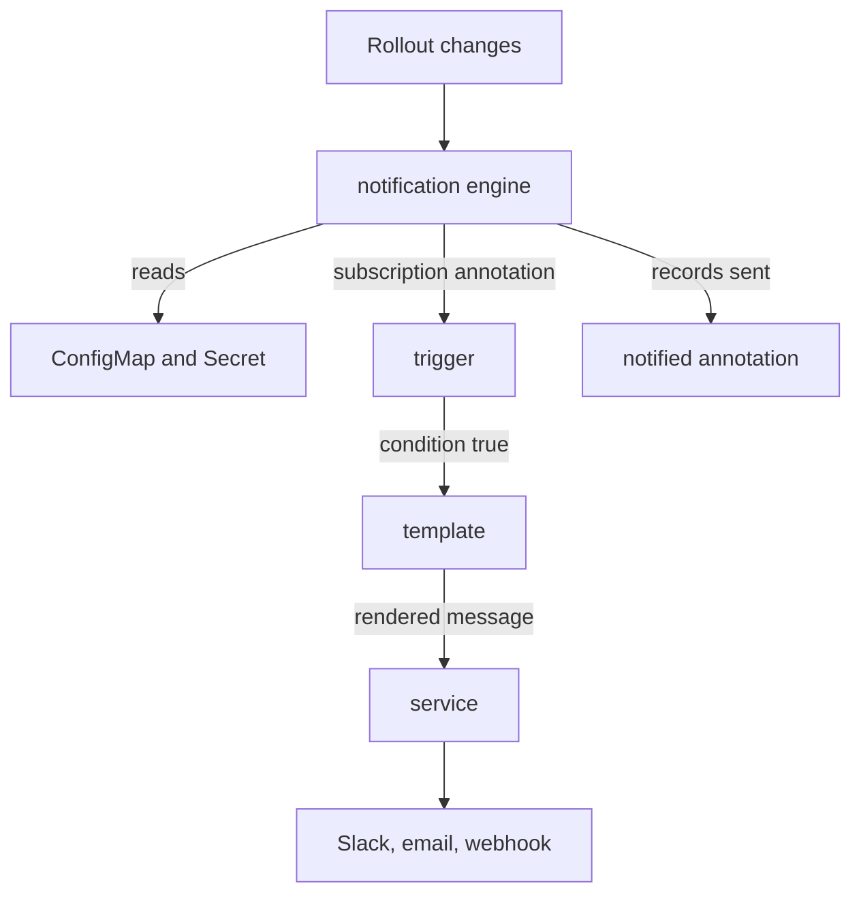

# How The Notification Engine Works

Watching a release means somebody must look at it. The notification engine moves this work to a message: the controller checks conditions on each `Rollout` and sends a message to a chat tool, an email system or a web address. To write a working notification, you need to know where the engine runs, what it reads, in which order it evaluates the pieces and where it stores what it has already sent. This part names the pieces and follows one message from the change of a `Rollout` to its destination.

## The engine inside the controller

The Argo Rollouts controller embeds the Argo notifications engine, a library that Argo CD and Argo Workflows use too. No extra pod is needed. The engine runs as a second control loop in the same process. It watches `Rollout` objects, and each time a `Rollout` changes, it takes the new object and evaluates it. It does not run on a timer. A `Rollout` that nobody changes, and whose status the controller does not update, is not evaluated again.

The evaluation has a fixed order:

1. The engine reads the ConfigMap and the Secret that hold the configuration.
2. It reads the subscription annotations of the `Rollout` to find the triggers and services the `Rollout` wants.
3. For each subscribed trigger, it evaluates the condition against the `Rollout` object.
4. For a condition that is true, it checks whether it has already sent this message, renders the templates, and sends the result through the service.
5. It records what it sent in an annotation on the `Rollout`.

A change in the ConfigMap takes effect on the next evaluation. The controller does not need a restart for a new service, template or trigger, because the engine reads the ConfigMap through a watch and keeps the latest version in memory.

## The four parts of the configuration

The configuration has four parts, and each one answers one question.

- A **service** says where messages can be sent: Slack, email, Microsoft Teams, a generic webhook and others. A service holds the address and the credentials.
- A **template** says what a message looks like. It is text with placeholders for fields of the `Rollout`.
- A **trigger** says when a message is sent. It is a condition on the `Rollout`, and it names the templates to send.
- A **subscription** says who receives the message. It is an annotation on the `Rollout`.

The first three live in a ConfigMap named `argo-rollouts-notification-configmap` in the namespace of the controller. Secrets, such as a Slack token, live in a Secret named `argo-rollouts-notification-secret` in the same namespace. A service entry refers to a Secret key with `$key-name`, so the token never appears in the ConfigMap. The subscription lives on the `Rollout`, so each team decides for its own `Rollout` which events it wants, and the configuration of the services stays with the administrator of the controller.



The diagram shows the path of one message from a change of the `Rollout` to the destination, and the annotation where the engine records it.

## Where the state lives

The engine keeps no database. Its only memory is the annotation `notified.notifications.argoproj.io` on the `Rollout`, where it writes which trigger it has fired for which value. This has three consequences. A restart of the controller does not send messages again, because the annotation survives. A `Rollout` that is deleted and created again sends its messages again, because the new object has no annotation. A person who deletes the annotation makes the engine send every message that is currently true once more.

## Looking at the objects

<!-- astrona:playground:renew -->

The installation creates the ConfigMap and the Secret. In the playground, the ConfigMap has no services, templates or triggers yet:

```sh
kubectl -n argo-rollouts get configmap argo-rollouts-notification-configmap -o yaml
kubectl -n argo-rollouts get secret argo-rollouts-notification-secret
```

The first command prints the ConfigMap, and its `data` has no entries. The second shows that the Secret exists. The command does not print the secret values, and you should not print them either.

The engine logs what it does in the controller log. A line that mentions a trigger or a service comes from the engine. Read the lines that mention notifications:

```sh
kubectl -n argo-rollouts logs deployment/argo-rollouts --since=10m | grep -i notification
```

With an empty ConfigMap the command prints few or no lines. After a trigger and a subscription exist, this is the place where a failed send and its reason appear, because the engine does not write errors into the `Rollout` status.

## What the controller needs to send

The controller pod sends every message itself, so it needs network access to the destination. A webhook to a Service inside the cluster works from the controller pod with the cluster DNS name of the Service. A Slack message needs outbound access to the Slack API, and a cluster with a network policy or an egress proxy on the controller namespace blocks it. The ClusterRole of the controller already lets it read the ConfigMap and the Secret and write the annotation on the `Rollout`.

A failed send is not retried from a queue. The engine logs the error and tries again at the next evaluation, which happens at the next change of the `Rollout`. A destination that is down for an hour therefore misses the messages of every change in that hour, except those whose condition is still true at the next change.

## What you know now

The notification engine runs inside the controller as a second control loop and evaluates a `Rollout` each time it changes. It reads services, templates and triggers from a ConfigMap, credentials from a Secret and subscriptions from an annotation on the `Rollout`, and it records what it sent in another annotation. The next question is how to write the services and templates.

## Common pitfalls

> [!WARNING]
> The ConfigMap and the Secret must be in the namespace of the controller, not in the namespace of the `Rollout`. A notification configuration in the wrong namespace is silently ignored. A failed send appears only in the controller log, never in the `Rollout` status.
