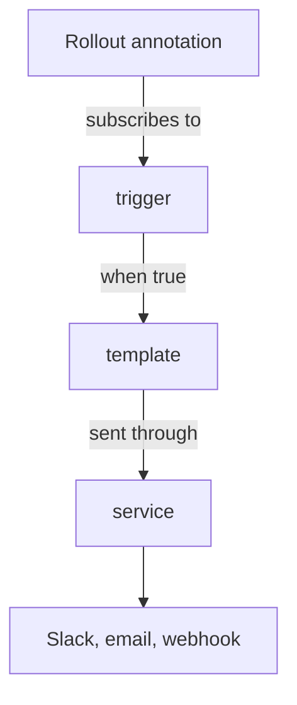

# How The Notification Engine Works

Watching a release means somebody must look at it. The notification engine moves this work to a message: the controller checks conditions on each `Rollout` and sends a message to a chat tool, an email system or a web address. This part names the pieces and shows where each one is stored.

## The engine inside the controller

The Argo Rollouts controller embeds the Argo notifications engine, which is a library shared with other Argo projects. No extra pod is needed. On every reconcile of a `Rollout`, the controller gives the object to the engine. The engine checks the triggers that the `Rollout` subscribes to and sends the messages for the triggers that fire.

## The four parts of the configuration

The configuration has four parts, and each one answers one question.

- A **service** says where messages can be sent: Slack, email, Microsoft Teams, a generic webhook and others. A service holds the address and the credentials.
- A **template** says what a message looks like. It is text with placeholders for fields of the `Rollout`.
- A **trigger** says when a message is sent. It is a condition on the `Rollout`, and it names the templates to send.
- A **subscription** says who receives the message. It is an annotation on the `Rollout`.

The first three live in a ConfigMap named `argo-rollouts-notification-configmap` in the namespace of the controller. Secrets, such as a Slack token, live in a Secret named `argo-rollouts-notification-secret` in the same namespace. The subscription lives on the `Rollout`, so each team decides for its own `Rollout` which events it wants.



The diagram shows the path of one message from the subscription to the destination.

## Looking at the objects

<!-- astrona:playground:renew -->

The installation creates the ConfigMap and the Secret. In the playground, the ConfigMap has no services, templates or triggers yet:

```sh
kubectl -n argo-rollouts get configmap argo-rollouts-notification-configmap -o yaml
kubectl -n argo-rollouts get secret argo-rollouts-notification-secret
```

The first command prints the ConfigMap, and its `data` has no entries. The second shows that the Secret exists. The command does not print the secret values, and you should not print them either.

## What the controller needs to send

The controller needs network access to the destination. A webhook to a Service inside the cluster works from the controller pod. A Slack message needs outbound access to the Slack API. The ClusterRole of the controller already lets it read the ConfigMap and the Secret.

## What you know now

The notification engine runs inside the controller and uses four parts: services, templates, triggers and subscriptions. The first three are in a ConfigMap, the secrets are in a Secret, and the subscription is an annotation on the `Rollout`. The next question is how to write the services and templates.

## Common pitfalls

> [!WARNING]
> The ConfigMap and the Secret must be in the namespace of the controller, not in the namespace of the `Rollout`. A notification configuration in the wrong namespace is silently ignored.
