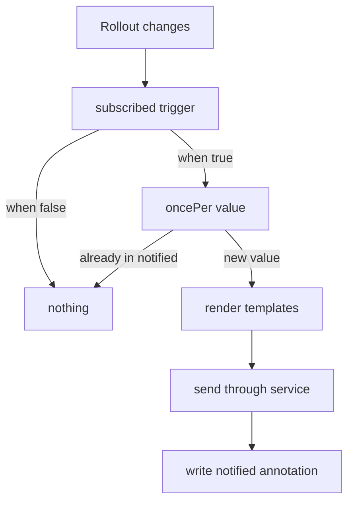

# Triggers And Subscriptions

A template does nothing until a trigger fires it and a `Rollout` subscribes to the trigger. The trigger is where most mistakes happen: a condition that is never true, a condition that is true too often, or a subscription that names a trigger that does not exist. This part shows how the engine evaluates a trigger, what `oncePer` changes, how an annotation connects a `Rollout` to a trigger and a service, and what the engine writes back so it does not send the same message twice.

## A trigger for a healthy release

A trigger is a key named `trigger.<name>` in the ConfigMap `argo-rollouts-notification-configmap`. Its value is a list of rules. Each rule has a `when` condition, an optional `oncePer` expression and a `send` list of template names. The condition is an expression over the `Rollout` object, which is available as `rollout`.

```yaml
trigger.on-healthy: |
  - when: rollout.status.phase == 'Healthy'
    oncePer: rollout.status.currentPodHash
    send: [rollout-healthy]
```

The condition is true while the phase is `Healthy`. The engine evaluates it each time the `Rollout` changes, and a `Rollout` changes often: every status update by the controller is a change. Without `oncePer`, the engine would send the message when the condition becomes true after being false, and again at every later change where it flips back to true. With `oncePer`, the engine sends one message for each distinct value of the expression. Here the value is the pod template hash, so each revision sends one message when it becomes healthy, and the later status updates of the same revision send nothing.

## How the engine evaluates a rule

The expression language is the one the Argo projects share. It has the usual comparisons (`==`, `!=`, `>`, `<`), the logical operators `&&`, `||` and `!`, and the operator `in` for lists. Every field of the `Rollout` is reachable with dots, with the same names as in the YAML: `rollout.spec.replicas`, `rollout.status.phase`, `rollout.status.abort` and `rollout.metadata.name`. A string is quoted with single quotes. A field that does not exist in the object makes the expression fail, and the engine logs the error and sends nothing.

Typical conditions use `rollout.status.phase`, for example `'Paused'` or `'Degraded'`, and `rollout.status.abort == true`. A rule can also look at the analysis runs through the status message, for example `rollout.status.message contains 'AnalysisRun'`.



The diagram shows the decision the engine takes for one trigger at one change of the `Rollout`.

The `oncePer` value is evaluated as a string. For `rollout.status.currentPodHash` it is the hash of the pod template. For `rollout.status.observedGeneration` it is a number that changes with every spec change, so a message is sent for every edit, not only for every new revision. A rule without `oncePer` has no record, and the engine sends on every change where the condition is true after it was false.

## Subscribing a Rollout

A subscription is an annotation on the `Rollout`. The key has this form: `notifications.argoproj.io/subscribe.<trigger>.<service>`. The value is the recipient, such as a Slack channel name. A webhook has no recipient, so the value is an empty string.

The annotation goes under `metadata.annotations` of the `Rollout`:

```yaml
metadata:
  name: mission
  namespace: starfleet
  annotations:
    notifications.argoproj.io/subscribe.on-healthy.probe: ""
```

The annotation names the trigger `on-healthy` and the service `probe`. Both must exist in the ConfigMap, or nothing is sent. Changing an annotation does not create a revision, because only the pod template defines one, and it does not restart the release.

<!-- astrona:playground:renew -->

Add the subscription to the playground `Rollout` and read it back:

```sh
kubectl -n starfleet annotate rollout mission notifications.argoproj.io/subscribe.on-healthy.probe=""
kubectl -n starfleet get rollout mission -o jsonpath='{.metadata.annotations}{"\n"}'
```

The second command prints the annotations of the `Rollout`, with the subscription key and an empty value. The `Rollout` has no new revision, and the controller starts no release. The ConfigMap in the playground holds no trigger named `on-healthy` yet, so the engine finds the subscription, finds no trigger and logs that it cannot evaluate it. Nothing is sent until the trigger and the service `probe` exist in the ConfigMap.

## Default triggers and the catalog

A cluster can define default triggers in the ConfigMap with the key `defaultTriggers`, a list of trigger names. A subscription annotation that names only a service, `notifications.argoproj.io/subscribe.<service>`, then uses these triggers. This lets an administrator decide that every subscribed `Rollout` reports an abort, without each team writing the trigger name. The Argo project also publishes a catalog of ready triggers and templates, for example for a paused, failed or completed rollout. A team can copy entries from the catalog and change them. The setup in this module defines its own entries, so no catalog is needed.

## What the engine remembers

After it sends a message, the engine writes the result into an annotation on the `Rollout`, named `notified.notifications.argoproj.io`. The value is a record with one entry for each combination of trigger, `oncePer` value, service and recipient that was already sent, with the time of the send. On the next change of the `Rollout`, the engine evaluates the trigger again, finds the entry and sends nothing.

This record is the whole memory of the engine. It survives a restart of the controller, because it is stored on the `Rollout`. A person who deletes the annotation makes the engine send again every message whose condition is true at that moment. A `Rollout` that is deleted and created again starts with an empty record.

## What you know now

A trigger is a rule with a condition, an optional `oncePer` expression and templates. The engine evaluates it at each change of the `Rollout`, sends when the condition is true and the `oncePer` value is new, and writes the send into the `notified` annotation. The annotation `notifications.argoproj.io/subscribe.<trigger>.<service>` connects a `Rollout` to the trigger and the service, and `defaultTriggers` fills in the trigger when the annotation names only a service. The next question is how to prove that it all works.

## Common pitfalls

> [!WARNING]
> A subscription that names a trigger or a service that does not exist sends nothing, and the failure appears only in the controller log. Without `oncePer`, a condition that flips between true and false sends many messages. An `oncePer` on `observedGeneration` sends for every spec edit, not only for every new revision.
