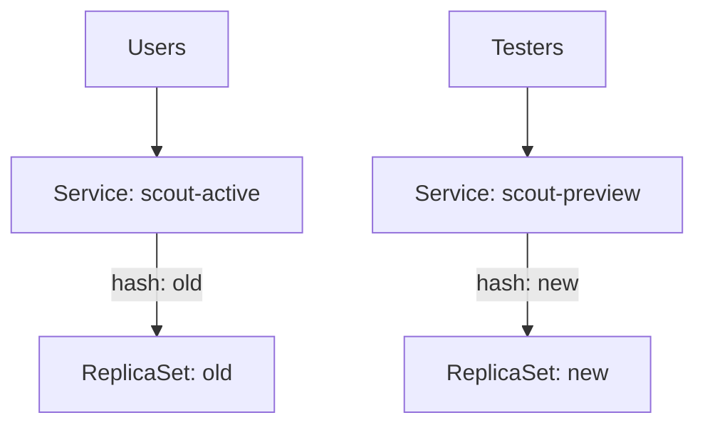

# Active And Preview Services

In a blue-green release, the `Rollout` keeps two complete sets of pods: the version that serves users now and the new version. Users reach only one of them at a time. This part shows how the two Services work, and how the switch between the versions is just a change of a Service selector.

## The two Services

A blue-green `Rollout` needs one Service and can use a second one. The `activeService` is required. It is the Service that users reach, and the controller points it at the active ReplicaSet. The `previewService` is optional. It points at the new ReplicaSet while the new version waits, so testers can reach it before users do.

Both Services are normal Kubernetes Services that you create. The `Rollout` only names them. Each Service starts with a selector for the application label, for example `app: scout`. The controller then adds a second selector entry, `rollouts-pod-template-hash`, and sets it to the hash of the ReplicaSet that the Service must reach.

Save this as `bluegreen-scout.yaml`. It creates both Services and a blue-green `Rollout`:

```yaml
apiVersion: v1
kind: Service
metadata:
  name: scout-active
  namespace: starfleet
spec:
  selector:
    app: scout
  ports:
  - port: 8080
    targetPort: 8080
---
apiVersion: v1
kind: Service
metadata:
  name: scout-preview
  namespace: starfleet
spec:
  selector:
    app: scout
  ports:
  - port: 8080
    targetPort: 8080
---
apiVersion: argoproj.io/v1alpha1
kind: Rollout
metadata:
  name: scout
  namespace: starfleet
spec:
  replicas: 2
  selector:
    matchLabels:
      app: scout
  template:
    metadata:
      labels:
        app: scout
    spec:
      containers:
      - name: scout
        image: docker.io/library/python:3.13-alpine
        command:
        - python
        - -m
        - http.server
        - '8080'
  strategy:
    blueGreen:
      activeService: scout-active
      previewService: scout-preview
      autoPromotionEnabled: false
```

<!-- astrona:playground:renew -->

Apply it:

```sh
kubectl apply -f bluegreen-scout.yaml
```

Then check what the controller did to the selectors:

```sh
kubectl -n starfleet get service scout-active -o jsonpath='{.spec.selector}{"\n"}'
kubectl -n starfleet get rollout scout -o jsonpath='{.status.currentPodHash} {.status.stableRS}{"\n"}'
```

The active Service now has the extra selector `rollouts-pod-template-hash`, with the same value as `stableRS`.

## The first revision has no earlier version

The first revision of a new `Rollout` has no older version to protect. The controller creates the ReplicaSet, waits until it is ready and points the active Service at it, even when `autoPromotionEnabled` is `false`. The setting only matters from the second revision on.

## What happens on the second revision

When you change the pod template, the controller creates a second ReplicaSet at full size. It does not touch the active Service. It points the preview Service at the new ReplicaSet. At this point both versions run completely, the active Service still reaches only the old pods, and the Rollout is in the phase `Paused` if `autoPromotionEnabled` is `false`.



The diagram shows that users stay on the old ReplicaSet while testers reach the new one through the preview Service.

Promotion changes one thing: the `rollouts-pod-template-hash` selector of the active Service becomes the hash of the new ReplicaSet. Kubernetes updates the Endpoints of the Service, and the next request goes to the new pods. No pod restarts, so the switch is fast. The old ReplicaSet stays up for a short time, as the next part explains.

## Why the selector approach has limits

The switch is a Service selector change, so it applies to new connections. Clients that keep an open TCP connection stay connected to the old pods until the connection ends. There is also a short delay while the Endpoints and the kube-proxy rules update on every node. A blue-green release does not give a sharp cut at a single instant, but it never mixes versions in one Service for long.

Blue-green also needs double the capacity during the release, because both versions run at full size. A cluster with no spare capacity cannot run a blue-green release for a large workload. If the nodes lack the room, the new pods stay `Pending` and the release never becomes ready.

## Common pitfalls

> [!WARNING]
> Do not add a `rollouts-pod-template-hash` selector to the Services yourself. The controller owns it and overwrites your value. A Service that is not named in `activeService` or `previewService` is never changed by the controller.
