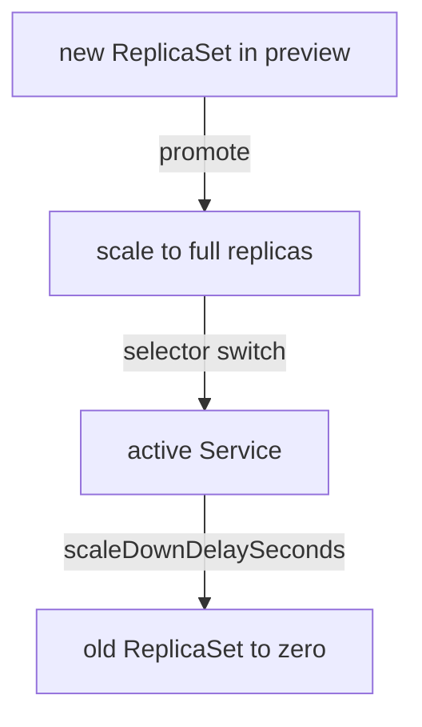

# Scale-Down And Preview Behaviour

A blue-green release runs two full sets of pods for a while. The cost of that and the speed of a rollback both depend on a few settings: how many pods the preview has, when the new revision goes live and when the old revision is removed. This part explains these settings and which component acts on each.

## Preview replicas

The field `previewReplicaCount` sets how many pods the new ReplicaSet runs while it waits in preview. Without it, the new ReplicaSet runs the full `spec.replicas`, and the cluster holds double capacity. With a value such as 1, the preview runs one pod, which is enough for a smoke test.

When the controller promotes the revision, it scales the new ReplicaSet to the full `spec.replicas` first and switches the active Service only after those pods are available. The switch therefore never points at fewer pods than the service needs.

Save this as `bluegreen-preview-count.yaml`:

```yaml
apiVersion: argoproj.io/v1alpha1
kind: Rollout
metadata:
  name: mission
  namespace: starfleet
spec:
  replicas: 3
  selector:
    matchLabels:
      app: mission
  template:
    metadata:
      labels:
        app: mission
    spec:
      containers:
      - name: mission
        image: docker.io/library/python:3.13-alpine
        command:
        - python
        - -m
        - http.server
        - '8080'
  strategy:
    blueGreen:
      activeService: active
      previewService: preview
      previewReplicaCount: 1
      autoPromotionEnabled: false
```

Apply it:

<!-- astrona:playground:renew -->

```sh
kubectl apply -f bluegreen-preview-count.yaml
```

Then check the result. After you change the image and apply again, the new ReplicaSet runs one pod while it waits:

```sh
kubectl -n starfleet get replicasets -l app=mission
```

## Automatic promotion

The field `autoPromotionEnabled` defaults to `true`. The controller then promotes the new revision as soon as its pods are available. With `false`, the release pauses in the phase `Paused` and waits for a promotion. The field `autoPromotionSeconds` sits between the two: the controller waits that many seconds after the new pods are available, then promotes by itself unless an operator acted first.

## Scaling down the old revision

After a promotion, the old ReplicaSet is no longer behind the active Service. The controller does not remove its pods at once. The field `scaleDownDelaySeconds` (default 30) holds them for that time, so requests that are still in flight, and connections that stay open, can finish. When the delay ends, the controller scales the old ReplicaSet to zero.

The field `scaleDownDelayRevisionLimit` sets how many old ReplicaSets may stay scaled up at the same time. When the limit is reached, the controller scales the oldest ones down at once, even if their delay is not over.

After an abort, the controller scales the new ReplicaSet down. The field `abortScaleDownDelaySeconds` sets the delay for this case.



The diagram shows the order the controller follows on a promotion: scale up, switch, wait, then scale down.

## What you know now

The preview can run fewer pods than production, a promotion scales up before it switches, and the old pods stay for a delay after the switch. The next question is how an operator runs these settings in production and what to check when a preview does not become ready.

## Common pitfalls

> [!WARNING]
> `previewReplicaCount` lowers the cost of a preview but also lowers the load a test can put on it: a preview with one pod does not show how three pods behave. A very short `scaleDownDelaySeconds` can cut requests that still run on the old pods.
