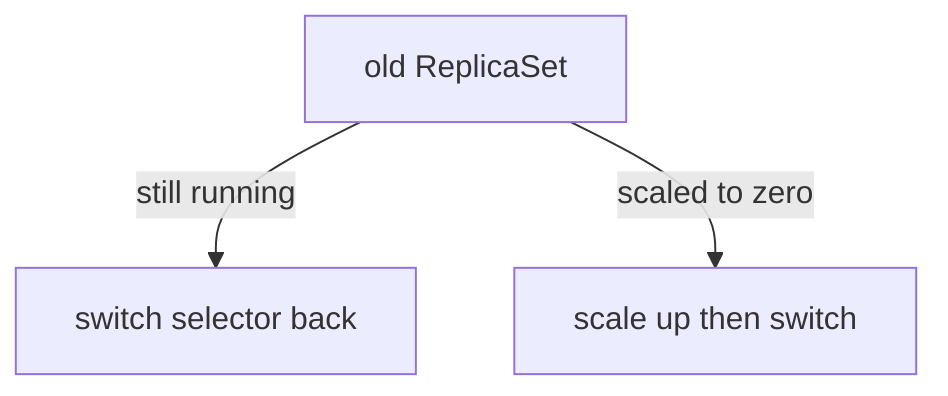

# Operating A Blue-Green Rollout

Running a blue-green release by hand means answering three questions: which pods does each Service send traffic to, why is the preview not ready, and how do I go back. The answers come from the selectors that the controller writes and from the status of the `Rollout`. This part shows how to read them.

## How the Services are switched

A blue-green `Rollout` names an `activeService` and, optionally, a `previewService`. The controller does not create these Services. They must exist, and their selector must match the pods of the `Rollout`. The controller then adds one more entry to the selector of each Service: the label `rollouts-pod-template-hash` with the hash of a ReplicaSet. The active Service gets the hash of the live revision, and the preview Service gets the hash of the new revision.

A promotion is therefore one change: the controller writes the new hash into the selector of the active Service. Kubernetes updates the endpoints of the Service, and the traffic moves. The status of the `Rollout` records the values in `status.blueGreen.activeSelector` and `status.blueGreen.previewSelector`.

Read the selectors that the controller wrote:

<!-- astrona:playground:renew -->

```sh
kubectl -n starfleet get service active -o jsonpath='{.spec.selector}{"\n"}'
kubectl -n starfleet get service preview -o jsonpath='{.spec.selector}{"\n"}'
kubectl -n starfleet get rollout mission -o jsonpath='{.status.blueGreen}{"\n"}'
```

The controller also adds the annotation `argo-rollouts.argoproj.io/managed-by-rollouts` to a Service it manages, with the name of the `Rollout`.

## Labelling the two sets of pods

The fields `activeMetadata` and `previewMetadata` under `strategy.blueGreen` hold labels and annotations that the controller puts on the pods of the active and the preview ReplicaSet. A monitoring rule can select `role: preview` pods without a change to the pod template. When a revision is promoted, the controller moves it from the preview metadata to the active metadata.

## A preview that does not become ready

When the new pods stay unready, the release stays in `Progressing`, the active Service keeps the old selector and users see no change. That is the safe outcome of the strategy. To find the cause, read the new pods:

```sh
kubectl -n starfleet get pods -l app=mission --show-labels
kubectl -n starfleet get endpoints preview
```

An empty endpoints list for `preview` means that no pod of the new revision is ready. After `progressDeadlineSeconds`, the phase becomes `Degraded`, and an abort or a corrected template ends it.

## Rolling back

Rollback in blue-green is a selector switch back. If the old ReplicaSet still runs, because the scale-down delay has not ended, the controller can point the active Service at it again without starting pods. If the old ReplicaSet was already scaled to zero, the controller must start its pods first and switch after they are available. A revision inside `rollbackWindow` skips the pre-promotion analysis.



The diagram shows that the speed of a rollback depends on whether the old pods still run.

## What you know now

The active Service moves with one selector change, the preview shows the new pods early, and a rollback is fast only while the old ReplicaSet is scaled up. The next module moves to the other strategy, where traffic shifts in small steps.

## Common pitfalls

> [!WARNING]
> Do not edit the `rollouts-pod-template-hash` entry in a Service selector by hand: the controller overwrites it on the next reconcile. A Service that does not exist, or whose selector does not match the pods, leaves the release waiting with no clear error in the status; check the controller log.
