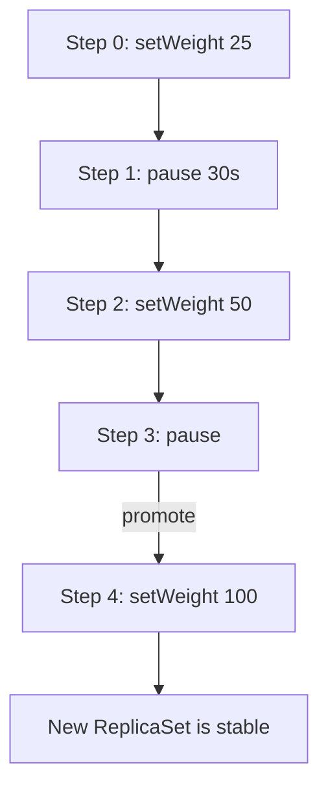

# Steps, Weights And Replica Counts

A canary strategy is an ordered list of steps. The controller runs one step at a time, and a step ends when its condition is met. This part explains the three step types you need most and shows how a weight turns into pod counts when there is no traffic router.

## The step list

The field `strategy.canary.steps` holds the list. The controller keeps the index of the current step in `status.currentStepIndex`. It starts at 0 for each new revision. When the last step ends, the new ReplicaSet becomes the stable one.

Three step types cover most releases:

- `setWeight: N` sets the share of the new version to N percent.
- `pause: {duration: 5m}` waits for the given time. The units are `s`, `m` and `h`, and a bare number counts seconds.
- `pause: {}` waits with no end, until an operator promotes the release.

Save this as `rollout-canary.yaml`:

```yaml
apiVersion: argoproj.io/v1alpha1
kind: Rollout
metadata:
  name: canary-demo
  namespace: starfleet
spec:
  replicas: 4
  selector:
    matchLabels:
      app: canary-demo
  template:
    metadata:
      labels:
        app: canary-demo
    spec:
      containers:
      - name: canary-demo
        image: docker.io/library/python:3.13-alpine
        env:
        - name: REVISION
          value: one
        command:
        - python
        - -m
        - http.server
        - '8080'
  strategy:
    canary:
      steps:
      - setWeight: 25
      - pause:
          duration: 30s
      - setWeight: 50
      - pause: {}
      - setWeight: 100
```

<!-- astrona:playground:renew -->

Apply it:

```sh
kubectl apply -f rollout-canary.yaml
```

Then check the result. The first revision of a Rollout has no older version to compare with, so the controller skips the steps and brings it to 100 percent:

```sh
kubectl -n starfleet wait --for=jsonpath='{.status.phase}'=Healthy rollout/canary-demo --timeout=240s
kubectl -n starfleet get rollout canary-demo -o jsonpath='{.status.currentStepIndex} {.status.stableRS}{"\n"}'
```

## From weight to replica counts

Without a traffic router, the controller can only change how many pods each ReplicaSet has. It calculates the number of canary pods from the weight and the total replicas, and rounds up. With 4 replicas, `setWeight: 25` gives 1 canary pod and 3 stable pods. `setWeight: 50` gives 2 canary pods and 2 stable pods. With 2 replicas, `setWeight: 25` also gives 1 canary pod, which is 50 percent in practice, because a pod cannot be divided.

Two settings limit how fast the controller can change the counts:

- `maxSurge` is the number of pods above the wanted total that may exist during the update. The default is 1. It can be a number or a percentage, and percentages round up.
- `maxUnavailable` is the number of pods that may be unavailable during the update. The default is 1. Percentages round down.

Both cannot be 0 at the same time, because the controller would have no room to start a new pod or stop an old one.



The diagram shows that the controller runs the steps in order and stops at an open-ended pause until a promotion.

## Releasing a second revision

When you change the pod template, the controller starts at step 0 for the new revision. At 25 percent it scales the new ReplicaSet to 1 pod and the old ReplicaSet to 3. It waits 30 seconds. At 50 percent it scales to 2 and 2, and it pauses with no time limit: the phase is `Paused` and the pause reason is `CanaryPauseStep`. After a promotion it goes to 100 percent, then scales the old ReplicaSet down after `scaleDownDelaySeconds` (default 30 seconds).

Throughout, the Service that selects only `app` reaches both versions. The share of requests that each version gets follows the pod counts only roughly. The next part shows how a router makes the share exact.

## Other step types

Besides `setWeight` and `pause`, the list can contain an `analysis` step (the controller waits for an AnalysisRun), an `experiment` step (the controller runs a temporary ReplicaSet), `setCanaryScale` (scales the canary independent of the weight, with a router), `setHeaderRoute` (routes by header) and `setMirrorRoute` (mirrors traffic). The analysis step is the subject of the analysis module.

## Common pitfalls

> [!WARNING]
> The first revision of a `Rollout` skips the steps, so a test of the steps needs a second revision. A weight of 10 with 3 replicas still creates 1 canary pod, which is 33 percent, because the controller rounds up.
