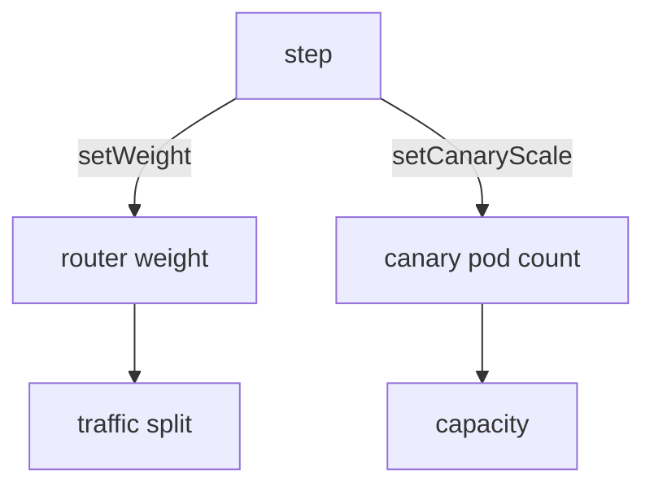

# Canary Scale Control

A canary step that says `setWeight: 20` does two jobs: it sets a share of traffic, and it sets how many pods run. Without a traffic router, the two are the same thing, because the share of requests follows the share of pods. With a traffic router they are separate. This part shows the settings that control the pod count and the capacity of both revisions.

## maxSurge and maxUnavailable

A canary strategy has the fields `maxSurge` and `maxUnavailable`, with the same meaning as in a Deployment. `maxSurge` is how many pods above `spec.replicas` may exist during the release. `maxUnavailable` is how many pods below `spec.replicas` may be unavailable. Both accept a number or a percentage, and both default to 25 percent.

With 4 replicas and a step of `setWeight: 25`, the controller runs 1 canary pod. It then scales the stable ReplicaSet down so that the total stays inside the limits.

Read the values of the playground `Rollout`:

<!-- astrona:playground:renew -->

```sh
kubectl -n starfleet get rollout mission -o jsonpath='{.spec.strategy.canary.maxSurge} {.spec.strategy.canary.maxUnavailable}{"\n"}'
```

An empty result means that the defaults apply.

## Scale control with a traffic router

When `trafficRouting` is set, the router splits the traffic, and the pod count no longer has to match the weight. The step `setCanaryScale` sets the canary pods on its own. It takes one of three forms:

- `replicas: 2` runs exactly 2 canary pods.
- `weight: 25` runs 25 percent of `spec.replicas` as canary pods, whatever the traffic weight is.
- `matchTrafficWeight: true` returns to the default, where the pod count follows the traffic weight.

This allows a step that sends 5 percent of traffic to a full-size canary, so the canary pods are not overloaded by the sample, or a step that tests a canary with no traffic.

Save this as `rollout-canary-scale.yaml`:

```yaml
apiVersion: argoproj.io/v1alpha1
kind: Rollout
metadata:
  name: mission
  namespace: starfleet
spec:
  replicas: 4
  selector:
    matchLabels:
      app: mission
  template:
    metadata:
      labels:
        app: mission
    spec:
      containers:
      - name: mission
        image: docker.io/library/python:3.13-alpine
        command:
        - python
        - -m
        - http.server
        - '8080'
  strategy:
    canary:
      stableService: mission-stable
      canaryService: mission-canary
      trafficRouting:
        nginx:
          stableIngress: mission
      steps:
      - setCanaryScale:
          replicas: 2
      - setWeight: 10
      - pause: {duration: 30s}
```

The file shows the form. It needs the two Services and an Ingress controller, so apply it only on a cluster that has them. A `setCanaryScale` step without `trafficRouting` is not valid.

## Keeping the stable pods

The field `dynamicStableScale: true` (with `trafficRouting`) scales the stable ReplicaSet down as the canary scales up, so the total stays near `spec.replicas`. Without it, the stable ReplicaSet keeps its full size during the release, which is safe for a fast abort and costs double capacity.

After the release, the controller keeps the old stable ReplicaSet for `scaleDownDelaySeconds` (default 30) when `trafficRouting` is set, so the router and its caches stop sending traffic to it first.



The diagram shows that with a traffic router, a weight sets the traffic split and `setCanaryScale` sets the capacity.

## What you know now

Pod counts follow the weight unless `setCanaryScale` or `dynamicStableScale` separates them. The limits `maxSurge` and `maxUnavailable` cap the total. The next question is how an operator controls a canary while it runs.

## Common pitfalls

> [!WARNING]
> `setCanaryScale` and `dynamicStableScale` only work with `trafficRouting`. Without a router, a weight of 10 on 4 replicas rounds to a number of pods, not to 10 percent of requests, so use a router when the exact share matters.
