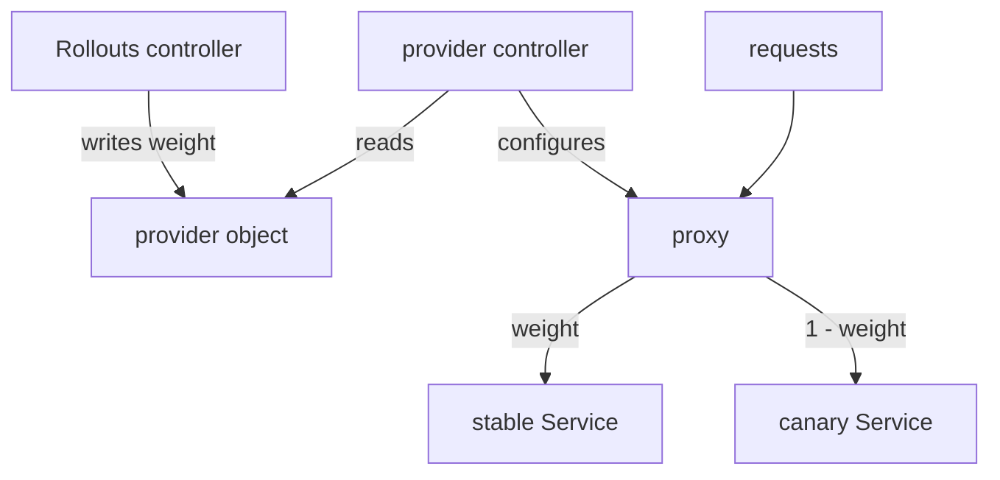

# How The Controller Drives A Provider

Providers differ in their objects, but the controller treats them in the same way. This part describes the common contract: the two Services, the weight written at each step, and the limits of what the controller does.

## The common contract

Every provider integration needs two Services. The `stableService` selects the stable pods and the `canaryService` selects the canary pods. The controller adds the label `rollouts-pod-template-hash` to the selector of each Service, with the hash of the stable ReplicaSet and of the canary ReplicaSet. Both Services must exist before the release, and the controller does not create them.

The `trafficRouting` block of the canary strategy then names the provider and the provider objects. When a step reaches `setWeight`, the controller does two things. It scales the canary ReplicaSet as needed, and it writes the weight into the provider object. The provider applies the weight to the requests.

## Division of work

Three components take part, and each one has one job.

- The Rollouts controller decides the weight and edits the provider object. It never sees a request.
- The provider controller, for example the NGINX Ingress controller or the Istio control plane, reads the edited object and configures the data path.
- The data path, a proxy such as NGINX or Envoy, splits the requests.



The diagram shows that the Rollouts controller only writes an object, and the proxy that another component configures splits the requests.

## Reading what the controller recorded

<!-- astrona:playground:renew -->

The Rollout status reports the weights that the controller believes are set. In the playground, the Rollout `mission` has no router yet. Read the Services and the status fields that hold the weights:

```sh
kubectl -n starfleet get service mission-stable mission-canary -o wide
kubectl -n starfleet get rollout mission -o jsonpath='{.status.canary.weights}{"\n"}'
```

The first command prints both Services with their selectors. The second prints nothing at this point, because no router is configured. When a router is in use, the status holds the canary and stable weights, so a person can compare them with the provider object.

## What can go wrong

If the provider object is missing, the controller reports the error in the Rollout status and does not advance. If the provider controller is missing, the object is edited but no traffic changes, and the release seems normal. A release can therefore pass all its steps with the weight set only on paper. Always check the real traffic split with requests when a router is new.

## What you know now

The controller needs two Services, writes a weight into a provider object and leaves the splitting to the provider. The next question is how this works for NGINX.

## Common pitfalls

> [!WARNING]
> A missing provider controller does not stop the Rollout. The weights in the Rollout status then do not prove that users see the split. Do not use a stable Service name for other traffic, since the controller edits its selector.
