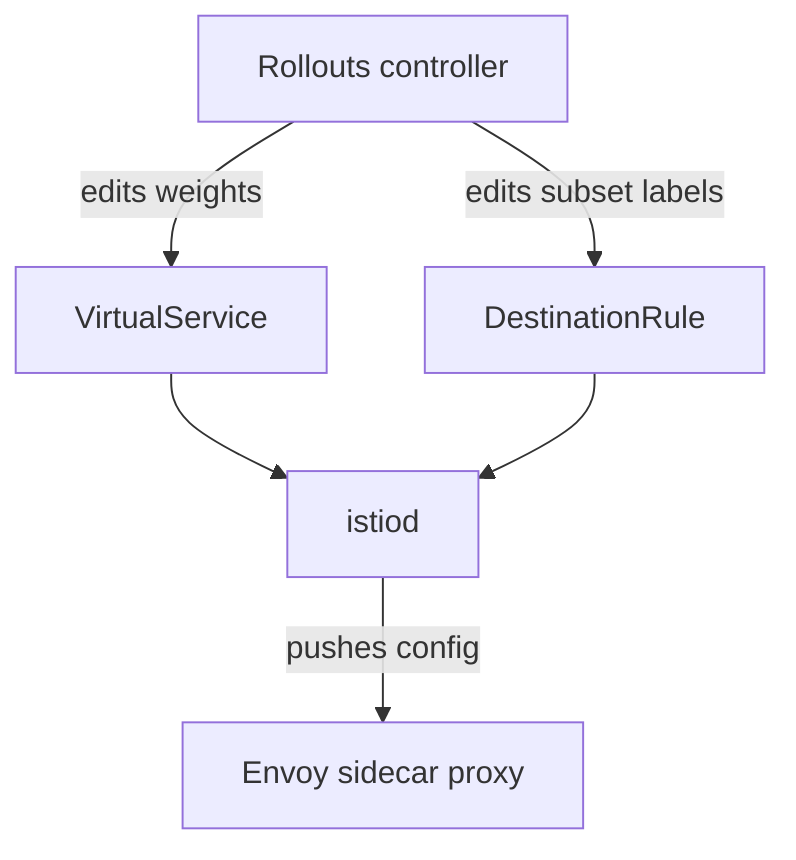

# The Istio Provider

Istio is a service mesh: a set of proxies and a control plane that route traffic between Services. A `VirtualService` is an Istio object that defines routes and weights. This part shows the two ways in which the Rollouts controller edits Istio objects.

## Splitting between two Services

In the first way, the `VirtualService` has one route with two destinations, the stable Service and the canary Service, each with a `weight`. The Rollout names the `VirtualService` and the route. The controller then edits the `weight` values of the two destinations at each `setWeight` step.

```yaml
strategy:
  canary:
    stableService: mission-stable
    canaryService: mission-canary
    trafficRouting:
      istio:
        virtualService:
          name: mission-vsvc
          routes:
          - primary
```

The `routes` list names the HTTP routes the controller may edit. Each of these routes must have exactly two destinations whose hosts are the stable and the canary Service names.

<!-- astrona:playground:renew -->

The Istio CRDs are not in the playground. Use `kubectl explain` against the Rollout CRD to see the fields that it accepts:

```sh
kubectl explain rollout.spec.strategy.canary.trafficRouting.istio.virtualService
kubectl explain rollout.spec.strategy.canary.trafficRouting.istio.destinationRule
```

## Splitting by subset

In the second way, there is one Service, and a `DestinationRule` defines two subsets. A subset is a named group of pods selected by labels. The `VirtualService` routes to the subsets, and the controller edits their weights. The Rollout names the `DestinationRule` and the subset names:

```yaml
trafficRouting:
  istio:
    virtualService:
      name: mission-vsvc
      routes:
      - primary
    destinationRule:
      name: mission-destrule
      canarySubsetName: canary
      stableSubsetName: stable
```

The controller adds the pod template hash to the labels of the two subsets in the `DestinationRule`, and it edits the weights in the `VirtualService`. This way needs only one Service, and `stableService` and `canaryService` are not used.



The diagram shows that the Rollouts controller edits the Istio objects and the Istio control plane, istiod, pushes the result to the Envoy sidecar proxies.

## Other Istio routes

The `virtualService` block also accepts `tlsRoutes` and `tcpRoutes` for non-HTTP traffic, with port and server name matches. The field `virtualServices` takes a list when one Rollout must edit more than one `VirtualService`, for example one for the mesh and one for a gateway. Istio is also the provider that supports both header routes and mirror routes in a canary.

## What you know now

The Istio integration edits a `VirtualService`, and optionally a `DestinationRule`. Weights go to two destinations or two subsets. The data path is the Envoy sidecar proxy. The last part lists the other providers.

## Common pitfalls

> [!WARNING]
> A route that has more than two destinations, or a destination with an unexpected host, makes the controller report an error and stop. The `VirtualService` must exist before the Rollout. Manually edited weights are overwritten at the next step.
