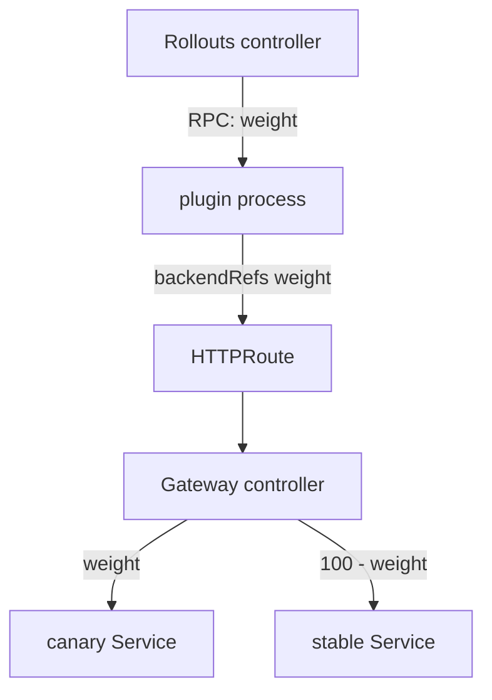

# Other Providers And The Plugin Route

NGINX and Istio are two of several supported providers. A team may run a cloud load balancer, a mesh with another API, or the Kubernetes Gateway API. Every provider follows the same contract: the Rollout names a stable Service and a canary Service, and the controller writes the weight of the current step into the object that the provider reads. What differs is the object and who edits it. This part lists the built-in providers, shows what happens when a Rollout names two of them, and explains the plugin route, where a separate binary edits the object instead of the controller.

## The built-in providers

Each provider has its own key under `trafficRouting`, and each one edits the object of its own system.

| Provider | Key | What the controller edits |
| --- | --- | --- |
| AWS Application Load Balancer | `alb` | A forward action in the annotations of the Ingress |
| Service Mesh Interface | `smi` | The weights of a `TrafficSplit` |
| Traefik | `traefik` | The weights of a `TraefikService` |
| Ambassador | `ambassador` | Canary `Mapping` objects |
| Apache APISIX | `apisix` | The weights of an `ApisixRoute` |

The ALB integration needs the AWS Load Balancer Controller, which reads the Ingress annotations and programs the load balancer. SMI is a specification for mesh traffic splits, and a mesh that implements it applies the `TrafficSplit`. In every case the Rollouts controller writes the weight and another controller turns it into routing. The details of each provider are in its own section of the project documentation, and the exam asks for the idea, not every field.

## Combining providers

The `trafficRouting` block accepts more than one provider in the same Rollout. This is used when a mesh handles traffic inside the cluster and an Ingress handles traffic from outside. The controller then sets the same weight in each provider on the same reconcile. A step that one of the providers does not implement, such as `setMirrorRoute` on a provider without mirroring, fails the step for the whole Rollout, so the combination supports only what both providers support.

## The plugin route and the Gateway API

The Kubernetes Gateway API is a newer standard for traffic routing, with objects such as `HTTPRoute`. The Rollouts controller does not edit these objects itself. It uses a traffic router plugin: a separate executable that the controller starts and calls over a local connection.

The plugin has a lifecycle of its own:

1. At start, the controller reads the ConfigMap `argo-rollouts-config` in its namespace. The key `trafficRouterPlugins` lists each plugin with a `name` and a `location`. The location is either a URL, which the controller downloads, or a `file://` path inside the controller container, which a volume or a custom image provides.
2. The controller starts the binary as a child process of the controller pod and connects to it over a local socket. The two processes exchange calls with a remote procedure call (RPC) protocol. The plugin runs with the ServiceAccount of the controller, so the ClusterRole of the controller must allow what the plugin edits, for example `httproutes` in the group `gateway.networking.k8s.io`.
3. On each step with a weight, the controller calls the plugin with the Rollout and the weight. The plugin edits the object of its system. For the Gateway API plugin, it sets the `weight` of the two `backendRefs` in the named `HTTPRoute`, one for the stable Service and one for the canary Service.
4. The Gateway controller, for example Envoy Gateway or Istio, reads the changed `HTTPRoute` and programs its proxy.

The plugin list is read once, at start. A new or changed plugin entry needs a restart of the controller Deployment, unlike a change of a Rollout, which the controller sees at once.



The diagram shows the chain from the controller through the plugin to the `HTTPRoute` and the Gateway controller that enforces the weight.

A Rollout uses the plugin through `trafficRouting.plugins`, with the plugin name as key and the plugin settings below it. For the Gateway API plugin, the settings name the `HTTPRoute` and its namespace:

```yaml
strategy:
  canary:
    stableService: mission-stable
    canaryService: mission-canary
    trafficRouting:
      plugins:
        argoproj-labs/gatewayAPI:
          httpRoute: mission-route
          namespace: starfleet
```

The `HTTPRoute` must exist before the release and must list both Services in its `backendRefs`, because the plugin changes weights and does not add backends. A missing route or a route without the canary Service makes the step fail, and the Rollout reports the error from the plugin in its conditions.

<!-- astrona:playground:renew -->

The playground has no Gateway API and no plugin, so the chain above cannot run here. Check where the controller reads its plugin settings and what the CRD accepts:

```sh
kubectl -n argo-rollouts get configmap argo-rollouts-config -o yaml
kubectl explain rollout.spec.strategy.canary.trafficRouting.plugins
```

The first command prints the controller ConfigMap, which has no `trafficRouterPlugins` key in the playground. The second prints the description of the `plugins` field, which the CRD defines as an open object, because the settings below the plugin name belong to the plugin and not to the controller.

## Choosing a provider

Use the provider that already carries your traffic. A cluster with the NGINX Ingress controller uses `nginx`. A cluster with Istio uses `istio`, preferably when header routing or mirroring is needed. A cluster that moves to the Gateway API uses the plugin. The Rollouts controller never installs the provider, and a Rollout that names a provider whose controller is not running writes weights that nobody reads, so every request keeps going to both Services through the normal selector.

## What you know now

Every provider follows the same contract of two Services and a written weight, and another controller turns the weight into routing. The built-in providers edit Ingress annotations, mesh objects or router objects. A plugin is a separate process that the controller starts from the `argo-rollouts-config` ConfigMap and calls with the weight on every step, and the Gateway API plugin writes that weight into the `backendRefs` of an `HTTPRoute`. The module closes with its main points.

## Common pitfalls

> [!WARNING]
> Feature support differs between providers. A step such as `setHeaderRoute` or `setMirrorRoute` is accepted by the CRD for any provider, but the provider may not implement it, and the Rollout then reports an error. A change to `trafficRouterPlugins` takes effect only after a restart of the controller. An `HTTPRoute` without the canary Service in its `backendRefs` fails the first weight step.
