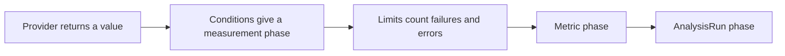

# Providers And Measurement Results

A provider is the part of a metric that takes the measurement. This part describes the three providers you need to know, how each one returns a value, and how the controller combines many measurements into one result for the metric.

## The job provider

The `job` provider creates a Kubernetes Job for each measurement. The field `provider.job.spec` is a normal Job spec. The measurement is `Successful` when the Job completes and `Failed` when the Job fails. The provider can run any check that a container can run, so it fits tests that no other provider supports. Two details matter. Set `backoffLimit: 0`, so a failed Job is not retried inside one measurement. Set `restartPolicy: Never`, because Jobs do not allow `Always`.

The Job pod runs in the namespace of the `AnalysisRun`. It uses the default service account of that namespace unless the pod template names another one.

## The web provider

The `web` provider sends an HTTP request from the controller. The controller makes the request, not a pod in the cluster. The main fields are `url`, `method`, `headers`, `timeoutSeconds` and `jsonPath`. The response body is parsed as JSON. `jsonPath` selects a part of it, and the selected value becomes `result`.

```yaml
metrics:
- name: health
  interval: 15s
  count: 4
  successCondition: result == "ok"
  provider:
    web:
      url: http://probe.starfleet.svc.cluster.local:8080/health
      jsonPath: "{$.status}"
      timeoutSeconds: 10
```

Because the controller sends the request, the URL must be reachable from the `argo-rollouts` namespace, and the response must be JSON.

## The prometheus provider

The `prometheus` provider runs an instant query against a Prometheus server. The fields are `address` and `query`. The query result is a vector, so the first sample is `result[0]`.

```yaml
metrics:
- name: success-rate
  interval: 1m
  count: 5
  successCondition: result[0] >= 0.95
  failureLimit: 1
  provider:
    prometheus:
      address: http://prometheus.monitoring.svc.cluster.local:9090
      query: |
        sum(rate(http_requests_total{app="mission",code!~"5.."}[2m]))
        / sum(rate(http_requests_total{app="mission"}[2m]))
```

An empty vector is a common problem. When the query returns no samples, `result[0]` cannot be read, and the measurement ends in an error. Use a query that always returns a value, for example by adding `or vector(0)`.

Other providers exist, among them `datadog`, `newRelic`, `cloudWatch`, `wavefront`, `graphite`, `influxdb`, `skywalking` and `kayenta`. They follow the same model: a query, a `result` value and the same conditions.

## From measurements to a metric result

Each measurement has its own phase: `Successful`, `Failed`, `Inconclusive` or `Error`. The controller combines them with the limits:

- When failed measurements exceed `failureLimit`, the metric is `Failed`.
- When inconclusive measurements exceed `inconclusiveLimit`, the metric is `Inconclusive`.
- When errors in a row exceed `consecutiveErrorLimit`, the metric is `Error`.
- When `count` measurements are done and none of the limits is exceeded, the metric is `Successful`.

The run is the sum of its metrics. One failed metric fails the run. All metrics successful makes the run `Successful`.



The diagram shows that the provider, the conditions and the limits each narrow the result before it reaches the run.

<!-- astrona:playground:renew -->

## Reading a provider result

The `probe` Service answers `/work?status=NNN` with the given HTTP status. To see what a check against it does, create an `AnalysisRun` from the template of the previous part. Save this as `analysis-run.yaml`:

```yaml
apiVersion: argoproj.io/v1alpha1
kind: AnalysisRun
metadata:
  name: probe-status-run
  namespace: starfleet
spec:
  args:
  - name: status
    value: "200"
  metrics:
  - name: probe-ok
    count: 1
    provider:
      job:
        spec:
          backoffLimit: 0
          template:
            spec:
              restartPolicy: Never
              containers:
              - name: check
                image: docker.io/library/python:3.13-alpine
                command:
                - python
                - -c
                args:
                - import urllib.request; urllib.request.urlopen("http://probe:8080/work?status={{ args.status }}", timeout=4)
```

Apply it and read the phase and the measurements:

```sh
kubectl apply -f analysis-run.yaml
kubectl -n starfleet wait --for=jsonpath='{.status.phase}'=Successful analysisrun/probe-status-run --timeout=120s
kubectl -n starfleet get analysisrun probe-status-run -o jsonpath='{.status.metricResults}'
```

To see a failure, change `status` to `"500"`, rename the run, and apply it again. The Job fails because the request returns an HTTP error, and the run ends in the `Failed` phase.

## Common pitfalls

> [!WARNING]
> The `web` provider calls from the controller, not from a pod. A Prometheus query that returns an empty vector gives an error, not a failure. An `Inconclusive` measurement needs both conditions to be set, because otherwise a measurement is either successful or failed.
