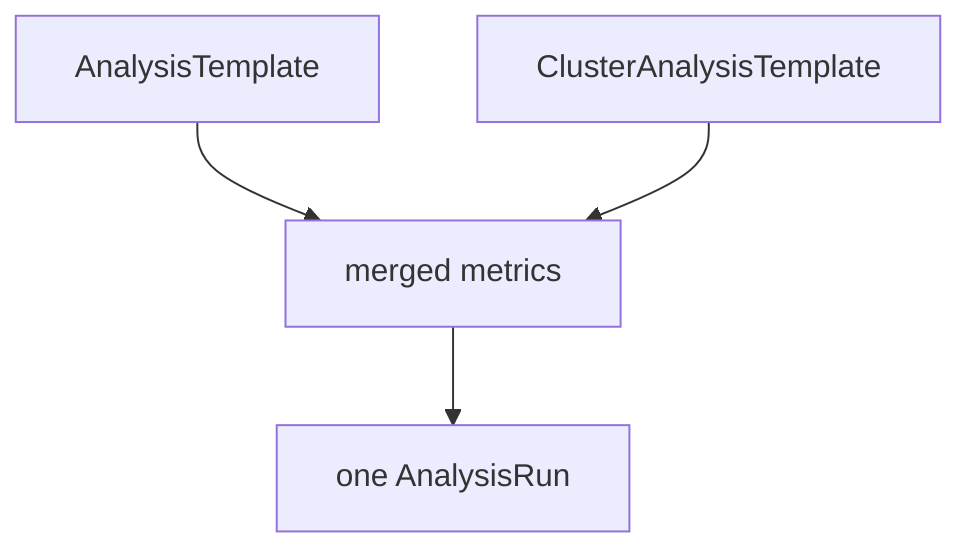

# Cluster Templates And Argument Sources

A team that runs many `Rollout` objects does not want to copy the same `AnalysisTemplate` into every namespace. It also does not want a token or a URL written into a template that many people can read. Argo Rollouts has two features for this: a template without a namespace, and arguments that read their value from another object. This part explains both and how a `Rollout` combines templates.

## ClusterAnalysisTemplate

A `ClusterAnalysisTemplate` has the same `spec` as an `AnalysisTemplate` and no namespace. A `Rollout` in any namespace can use it. To use one, the analysis entry of the `Rollout` lists it under `templates` with `clusterScope: true`:

```yaml
      analysis:
        templates:
        - templateName: success-rate
          clusterScope: true
```

Without `clusterScope: true`, the controller looks for a namespaced `AnalysisTemplate` with that name and does not find it. The `ClusterAnalysisTemplate` is created and changed by a cluster administrator, because it is cluster-wide.

Create one in the playground:

Save this as `clusteranalysistemplate-probe-up.yaml`:

```yaml
apiVersion: argoproj.io/v1alpha1
kind: ClusterAnalysisTemplate
metadata:
  name: probe-up
spec:
  args:
  - name: service
  metrics:
  - name: probe-up
    count: 1
    provider:
      job:
        spec:
          backoffLimit: 0
          template:
            spec:
              restartPolicy: Never
              containers:
              - name: check
                image: docker.io/library/python:3.13-alpine
                command:
                - python
                - -c
                - "import urllib.request; urllib.request.urlopen('http://{{ args.service }}:8080/', timeout=5)"
```

Apply it:

<!-- astrona:playground:renew -->

```sh
kubectl apply -f clusteranalysistemplate-probe-up.yaml
```

Then check the result. The object has no namespace:

```sh
kubectl get clusteranalysistemplates
```

## Arguments with a default, from a Secret or from the Rollout

An argument can take its value in three ways. A `value` is a default. A `valueFrom.secretKeyRef` reads one key of a Secret in the namespace of the `AnalysisRun`, so a token never appears in a template or in a `Rollout`. A `valueFrom.fieldRef` reads a field of the `Rollout`, for example the metadata of the object.

```yaml
  args:
  - name: api-token
    valueFrom:
      secretKeyRef:
        name: metrics-credentials
        key: token
  - name: service-name
    valueFrom:
      fieldRef:
        fieldPath: metadata.labels['app']
```

The snippet shows the two forms, for reading. An argument with no value that the `Rollout` or the `AnalysisRun` does not set makes the run end in the `Error` phase.

## Several templates in one analysis

The list `templates` can hold more than one entry. The controller merges the metrics of all templates into one `AnalysisRun`. Metric names must be unique across the merged templates, or the controller reports an error. An argument that has the same name in two templates takes one value from the `args` list of the analysis.



The diagram shows that the metrics of the listed templates become one `AnalysisRun`.

## What you know now

A cluster template is shared across namespaces, an argument can come from a Secret or a field, and several templates can run as one `AnalysisRun`. The next question is how the limits and the counters of a metric decide its outcome in more detail.

## Common pitfalls

> [!WARNING]
> Forgetting `clusterScope: true` is the most common reason a shared template is not found. A Secret that does not exist in the namespace of the run makes the run fail with an error before it takes any measurement.
