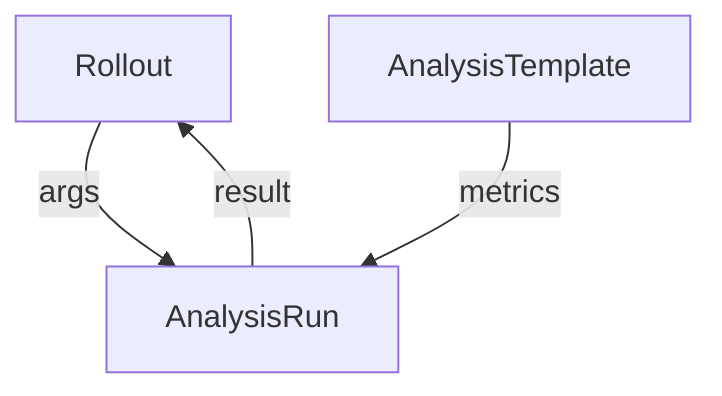

# Passing Rollout Data Into An Analysis

A metric is only useful when it measures the right pods. During a canary, the query must select the canary pods, not the stable ones, and the pod names change with each revision. The `Rollout` therefore has to pass facts about the current release to the `AnalysisRun`. This part shows how arguments carry those facts and how an operator can start an `AnalysisRun` by hand.

## The analysis arguments

The `args` list of an analysis entry in a `Rollout` sets the arguments of the template. Each entry has a `name` and a `value`, or a `valueFrom`. For release data, `valueFrom` has two forms:

- `podTemplateHashValue` takes the value `Latest` or `Stable`. It gives the pod template hash of the newest ReplicaSet or of the stable ReplicaSet.
- `fieldRef.fieldPath` reads a field of the `Rollout`, for example `metadata.labels['app']`.

A template can use the hash in a query that selects pods by the label `rollouts-pod-template-hash`, so it measures exactly the canary pods.

Save this as `rollout-analysis-args.yaml`:

```yaml
apiVersion: argoproj.io/v1alpha1
kind: Rollout
metadata:
  name: mission
  namespace: starfleet
spec:
  replicas: 2
  selector:
    matchLabels:
      app: mission
  template:
    metadata:
      labels:
        app: mission
    spec:
      containers:
      - name: mission
        image: docker.io/library/python:3.13-alpine
        command:
        - python
        - -m
        - http.server
        - '8080'
  strategy:
    canary:
      analysis:
        templates:
        - templateName: probe-gate
        startingStep: 1
        args:
        - name: status
          value: "200"
      steps:
      - setWeight: 50
      - pause: {duration: 30s}
```

The template `probe-gate` takes an argument `status`. The `Rollout` sets it to `"200"`, and the value overrides the default of the template. A template that needs the pod hash would declare an argument such as `canary-hash`, and the `Rollout` would set it with `valueFrom.podTemplateHashValue: Latest`.

Apply it:

<!-- astrona:playground:renew -->

```sh
kubectl apply -f rollout-analysis-args.yaml
```

Then check the result. The command lists the `AnalysisRun` objects that the `Rollout` created:

```sh
kubectl -n starfleet get analysisruns
```

## Where an AnalysisRun comes from

The controller creates an `AnalysisRun` for each analysis entry that starts, sets the `Rollout` as its owner and copies the metrics and the resolved arguments into it. When the `Rollout` is deleted, the owned runs go with it. The controller also keeps a limited number of finished runs, set by `spec.analysis.successfulRunHistoryLimit` and `spec.analysis.unsuccessfulRunHistoryLimit`.

## Creating a run by hand

An operator can also create an `AnalysisRun` with `kubectl`, with a `spec` that has `metrics` and `args`. The run executes the same way, with no `Rollout`. This is useful to test a template before it is used in a release. The field `spec.terminate: true` stops a running `AnalysisRun`; the run ends with the result it has so far.



The diagram shows that the `Rollout` and the template feed the run, and the run returns its result to the `Rollout`.

## What you know now

Arguments connect a release to its measurement, either as a plain value, a field of the `Rollout` or the hash of a ReplicaSet. The `Rollout` creates and owns the runs, and an operator can run one alone. The next question is how to read a run that did not end well.

## Common pitfalls

> [!WARNING]
> An argument that has no default and is not set by the `Rollout` makes the run end in `Error`. A query that does not select by revision measures the stable pods too, and a bad canary may then pass.
