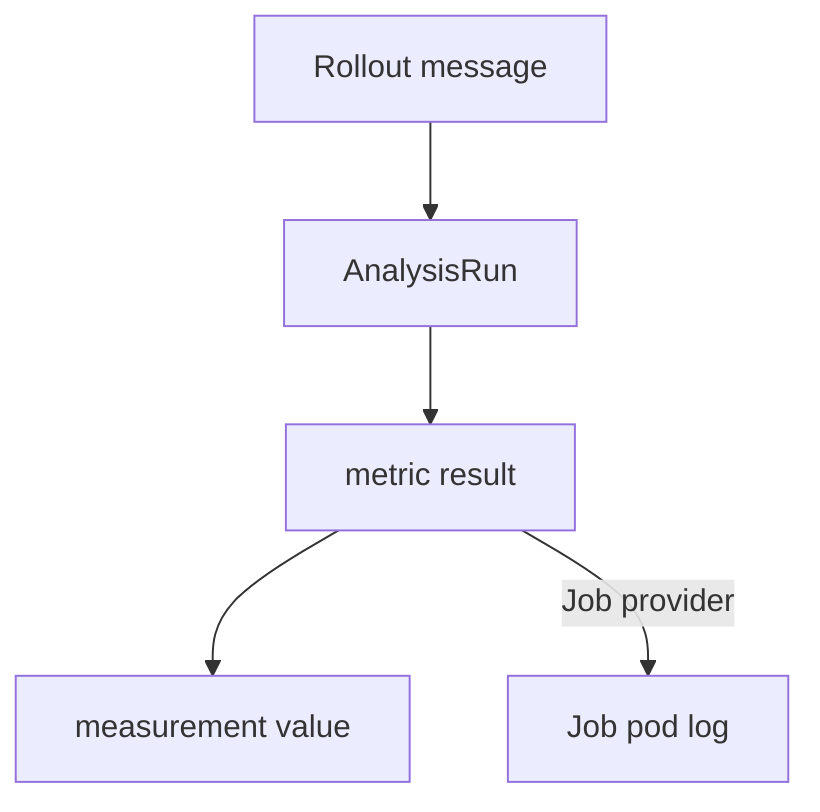

# Reading And Debugging An AnalysisRun

When a release aborts, the first question is which metric failed and why. The answer is in the status of the `AnalysisRun`. The status has one entry for each metric and one entry for each measurement. This part shows how to read it, from the phase of the run down to the value of one measurement.

## The phases of a run

A run starts as `Pending`, becomes `Running` while it measures and ends in one of three final phases: `Successful`, `Failed` or `Error`. It can also end as `Inconclusive`. A run with a background analysis that never ends stays `Running` until the release finishes or aborts, and the controller then terminates it.

The phase of the run follows the metrics. Any `Failed` metric fails the run. If no metric failed and one has `Error`, the run is `Error`. If no metric failed or errored and one is `Inconclusive`, the run is `Inconclusive`. Otherwise all metrics are `Successful`.

List the runs and their phases:

<!-- astrona:playground:renew -->

```sh
kubectl -n starfleet get analysisruns
```

## Reading the metric results

The field `status.metricResults` has one entry per metric. Each entry has the counters `count`, `successful`, `failed`, `inconclusive` and `error`, the phase of the metric and the list `measurements`. Each measurement has a `phase`, a `value`, a start and an end time and, for an error, a `message`.

Print the results of one run. Replace `<RUN_NAME>` with a name from the list:

```sh
kubectl -n starfleet get analysisrun <RUN_NAME> -o jsonpath='{.status.phase}{"\n"}{.status.message}{"\n"}'
kubectl -n starfleet get analysisrun <RUN_NAME> -o jsonpath='{range .status.metricResults[*]}{.name} {.phase} failed={.failed} error={.error}{"\n"}{end}'
```

The first command prints the phase and a short message. The second prints one line per metric. A `value` that does not look like what the condition expects is the usual reason for an unexpected failure: Prometheus returns a list, so `result[0]` is the first value, while a plain number is `result`.

## Finding why a Rollout aborted

The `Rollout` status shows the abort and the reason in `status.message`, and it names the failed run. The steps are:

1. Read `status.message` of the `Rollout` and note the run name.
2. Read the phase of that run and find the metric with a failed or error count.
3. Read the `measurements` of that metric: the `value` of a failure, or the `message` of an error.
4. For a Job provider, read the log of the Job pod, because the exit code decides the result.



The diagram shows the path from the aborted `Rollout` down to the evidence.

## Retrying after the fix

When the cause was the metric or the environment and not the application, correct it and retry the release. A retry creates a new `AnalysisRun`. The old run stays as a record until the history limit removes it.

## What you know now

The run has a phase, each metric has counters and each measurement has a value or an error message. Reading from the `Rollout` message down to the measurement finds the cause of an abort. The module summary closes the topic of analysis and releases.

## Common pitfalls

> [!WARNING]
> An `Error` is not a `Failed`: it says the measurement itself broke, so fix the query or the provider before you blame the application. Runs are removed by the history limits, so read the failed run before more releases push it out.
