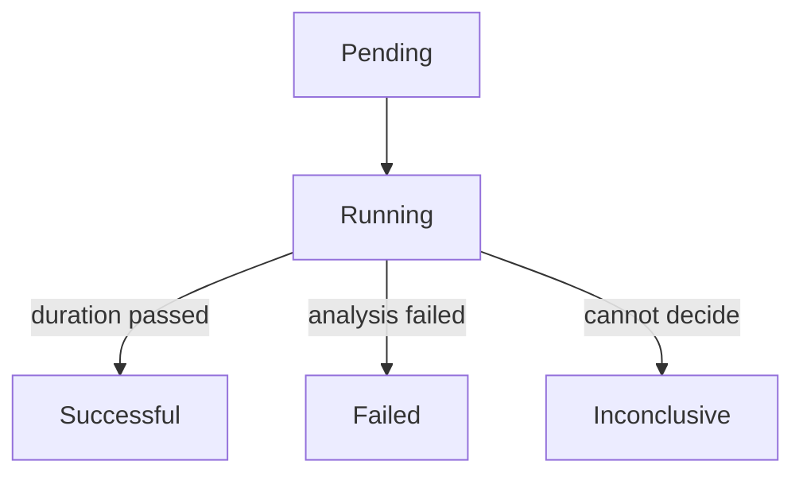

# The Experiment Resource

A team often asks whether a new version behaves as well as the old one under the same conditions. The `Experiment` resource answers this by running one or more ReplicaSets for a limited time. This part shows the fields of the resource and the phases it goes through.

## What an experiment runs

An `Experiment` is a namespaced custom resource. It creates one ReplicaSet for each entry in `spec.templates`. Each entry has a `name`, a `replicas` count, a `selector` and a pod `template`. The ReplicaSets exist for the time of the experiment and are scaled to zero afterwards. They receive traffic only if a `Service` is created for them, which is an option of the template.

The field `spec.duration` sets how long the experiment runs, for example `1m` or `20m`. Without a `duration`, the experiment ends when its analyses end.

## A first experiment

Save this as `experiment-baseline.yaml`:

```yaml
apiVersion: argoproj.io/v1alpha1
kind: Experiment
metadata:
  name: baseline
  namespace: starfleet
spec:
  duration: 1m
  templates:
  - name: baseline
    replicas: 1
    selector:
      matchLabels:
        app: baseline
    template:
      metadata:
        labels:
          app: baseline
      spec:
        containers:
        - name: baseline
          image: docker.io/library/python:3.13-alpine
          ports:
          - containerPort: 8080
          command:
          - python
          - -m
          - http.server
          - '8080'
```

<!-- astrona:playground:renew -->

Apply it:

```sh
kubectl apply -f experiment-baseline.yaml
```

Then check the result:

```sh
kubectl -n starfleet get experiment baseline
kubectl -n starfleet get replicasets,pods -l app=baseline
```

The experiment creates one ReplicaSet and one pod. After one minute, the experiment ends and the pod goes away.

## Phases

The `status.phase` of an experiment is one of these values:

- `Pending`: the controller has not started the experiment.
- `Running`: the ReplicaSets exist and the duration or the analyses are running.
- `Successful`: the duration passed and no analysis failed.
- `Failed`: an analysis failed, or a template did not become available in time.
- `Error`: the controller could not run the experiment.
- `Inconclusive`: an analysis could not decide.



The diagram shows the usual path of an experiment and the three ways it can end other than success.

## Services and deadlines

A template can have a `service` entry with a `name`. The controller then creates a Service for the pods of that template, so other pods can send requests to the experiment. The field `progressDeadlineSeconds` limits how long the controller waits for the template pods to become available, and `scaleDownDelaySeconds` sets how long they stay after the end.

## What you know now

An experiment runs temporary ReplicaSets for a set duration and ends in a final phase. It needs a selector that matches its pod labels. The next question is how an experiment measures anything.

## Common pitfalls

> [!WARNING]
> The `selector` must match the labels in the pod template, or the experiment is invalid. An experiment is a one-off object: once it is final it does not run again, so create a new one with a new name or delete the old one.
