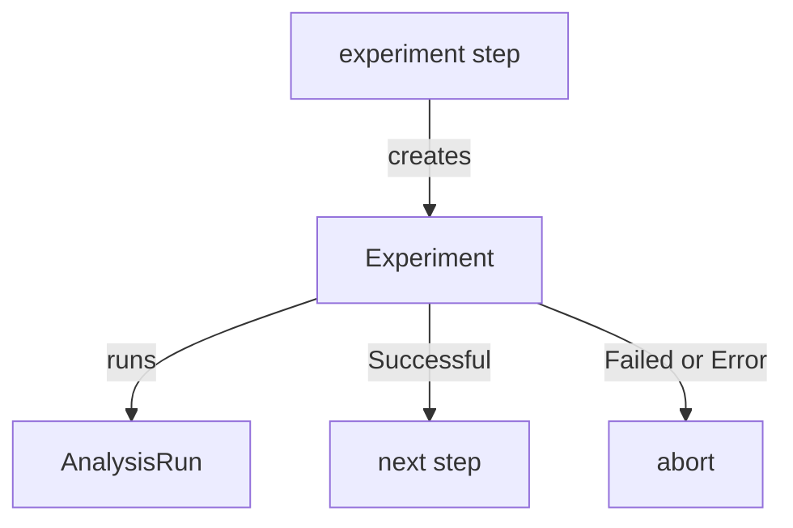

# Experiments In A Canary

A canary step can start an experiment, so the new and the stable version run side by side with an analysis, before any traffic moves. This part shows the `experiment` step and how the Rollout waits for its result.

## The experiment step

The step `experiment` goes in the steps of a canary. It describes the same things as an `Experiment`, with two differences. A template does not need its own pod spec, because `specRef` copies it from the `stable` or the `canary` ReplicaSet of the Rollout. The step also needs no selector, since the controller builds it.

```yaml
strategy:
  canary:
    steps:
    - experiment:
        duration: 1m
        templates:
        - name: baseline
          specRef: stable
        - name: candidate
          specRef: canary
        analyses:
        - name: probe-check
          templateName: probe-gate
    - setWeight: 50
```

<!-- astrona:playground:renew -->

When the Rollout reaches the step, the controller creates an `Experiment` that the Rollout owns. The step blocks the release until the experiment is final. Check the field list of the step in the CRD:

```sh
kubectl explain rollout.spec.strategy.canary.steps.experiment
kubectl explain rollout.spec.strategy.canary.steps.experiment.templates
```

## What happens at each result

A `Successful` experiment moves the Rollout to the next step. A `Failed` or `Error` experiment aborts the release, and the Rollout phase becomes `Degraded`. An `Inconclusive` experiment pauses the release, so a person can decide. These effects match those of an inline analysis step.



The diagram shows that the step creates the experiment, and the experiment result decides between the next step and an abort.

## Traffic to experiment pods

A template in the step can have a `weight` when the canary uses a traffic router. The controller then routes that share of requests to the template pods through a Service it creates. This is the way to test a version on a small share of real requests without a canary step. Without a router, the experiment pods get no user traffic, and the analysis alone measures them.

## Choosing between an experiment and an analysis

An inline analysis tests the canary that already receives its weight. An experiment tests copies of both versions under the same synthetic or controlled load, with no effect on users. Use an experiment when the stable version is needed as a baseline in the same test.

## What you know now

An `experiment` step starts an owned `Experiment` with templates copied from the stable and canary ReplicaSets. The result continues, aborts or pauses the release. The last part shows how to read and debug an experiment.

## Common pitfalls

> [!WARNING]
> The step adds the time of the experiment to the release, so keep the duration short.
