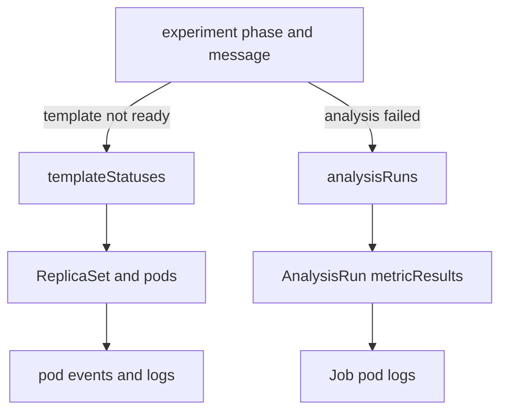

# Reading And Debugging An Experiment

An experiment is short and its pods disappear, so the evidence is easy to lose. When an experiment fails, the cause can sit in one of four places: the experiment spec, a ReplicaSet that never became ready, an `AnalysisRun` that failed, or the Job pods behind the run. Each place has its own object and its own status fields, and the `Experiment` controller writes a summary of all of them into the experiment status. This part shows the fields to read, who writes each one, and the order that finds the cause fastest.

## The status of an experiment

The `Experiment` controller, which runs inside the Argo Rollouts controller, writes `status` on every reconcile. It has three useful groups of fields. The `phase` and `message` give the overall result. The list `templateStatuses` has one entry for each template, with its `name`, `replicas`, `readyReplicas` and a `status` such as `Progressing`, `Running`, `Successful`, `Failed` or `Error`. The list `analysisRuns` has one entry for each analysis, with its `name`, the name of the `AnalysisRun` object and its `phase`.

The phases follow an order. A new experiment is `Pending` until the controller creates its ReplicaSets. It is `Running` while the pods run and the analyses measure. The field `status.availableAt` holds the time when every template reached its ready count, and the `duration` counts from that time, not from creation. A final phase is `Successful`, `Failed` or `Error`.

<!-- astrona:playground:renew -->

Read the fields with `kubectl`:

```sh
kubectl -n starfleet get experiment compare -o jsonpath='{.status.phase} {.status.availableAt} {.status.message}{"\n"}'
kubectl -n starfleet get experiment compare -o jsonpath='{range .status.templateStatuses[*]}{.name} {.status} {.readyReplicas}/{.replicas}{"\n"}{end}'
kubectl -n starfleet get experiment compare -o jsonpath='{range .status.analysisRuns[*]}{.name} {.analysisRun} {.phase}{"\n"}{end}'
```

The first command prints the result and the time at which the experiment became available. The second prints one line for each template with its ready count, and the third prints one line for each analysis with the name of its run. If the experiment named `compare` does not exist in your playground, use the name of the experiment you created.

## Who owns what

The controller creates one ReplicaSet for each template and one `AnalysisRun` for each analysis, and it sets an owner reference on each of them that points to the experiment. The pods belong to the ReplicaSets, and the Job pods of a `job` provider belong to Jobs that the `AnalysisRun` owns. Deleting the experiment therefore deletes the whole chain through the Kubernetes garbage collector. Read the chain in the namespace to see which objects an experiment created:

```sh
kubectl -n starfleet get replicasets,analysisruns,jobs -o jsonpath='{range .items[*]}{.kind} {.metadata.name} owned by {.metadata.ownerReferences[0].kind} {.metadata.ownerReferences[0].name}{"\n"}{end}'
```

The command prints one line per object with its owner. The ReplicaSets and runs of the experiment name `Experiment compare` as their owner. Jobs name an `AnalysisRun`. ReplicaSets of the `Rollout` name `Rollout mission`, which separates the pods of a release from the pods of an experiment.

## The order that finds the cause

Read from the summary to the detail. The experiment status points at the template or the analysis that failed, the template status points at a ReplicaSet, the analysis entry points at a run, and the run points at a Job and its pod.



The diagram shows the two paths from the experiment status to the object that holds the cause.

`kubectl describe experiment compare` prints the conditions and the events at the end. The events record when the ReplicaSets were created and scaled, and when the analyses started. Read them in order, because the first error is usually the cause:

```sh
kubectl -n starfleet describe experiment compare
```

The output ends with the events of the experiment, oldest first. A normal start shows one event for the creation of each ReplicaSet and one for the start of each analysis. An event with type `Warning` names the first thing that went wrong.

## Common reasons for a failure

The reasons fall into a few groups, and each one shows in a different field.

- **A template never became available.** The image could not be pulled, or a pod stayed `Pending`. The template status stays `Progressing`, `availableAt` stays empty, and the experiment fails after `progressDeadlineSeconds` (default 600). Read the pods and their events.
- **An analysis failed.** The experiment phase is `Failed`, the entry in `analysisRuns` shows `Failed`, and the message names the run. Read the `AnalysisRun`: the phase of each metric in `status.metricResults` and the measurements with their values.
- **The spec is invalid.** The selector does not match the template labels, or two templates have the same name. The phase is `Error` and the message names the problem. No ReplicaSet is created.
- **The analysis template is missing.** The analysis entry names an `AnalysisTemplate` that does not exist in the namespace. The experiment phase is `Error`, and no run exists to read.

An analysis that errors, for example because its Job image cannot be pulled, ends the experiment in `Error` rather than `Failed`. The difference matters for a canary: both results stop the release, but `Error` says the check could not run, and `Failed` says the check ran and the new version was bad.

## After the experiment

The experiment object stays after it ends, with its status. The ReplicaSets stay too, scaled to zero, and the `AnalysisRun` objects stay with all their measurements, because the experiment owns them. Deleting the experiment deletes all of them. A canary experiment is owned by the Rollout, and the history limits of the Rollout remove old ones.

The pods are the one thing that does not stay. The controller scales the ReplicaSets to zero when the experiment ends, and a pod that is gone has no log. A check whose output matters must write it where it survives: the measurement value of an `AnalysisRun`, which the run keeps, or an external system that the Job writes to.

## What you know now

The experiment status holds the phase, `availableAt`, one status per template and one entry per analysis, all written by the `Experiment` controller. Owner references link the experiment to its ReplicaSets, runs and Jobs, and reading from the summary to the detail finds the cause: a template that never became ready, a failed or errored run, an invalid spec or a missing template. The module closes with the main points.

## Common pitfalls

> [!WARNING]
> The pods of an experiment are scaled down at the end, so a log request after the end returns nothing. Read the logs while it runs, or use an analysis that stores its result in the measurements. An experiment whose template never becomes ready fails only after `progressDeadlineSeconds`, which is ten minutes by default, so a wrong image looks like a hang before it looks like a failure.
