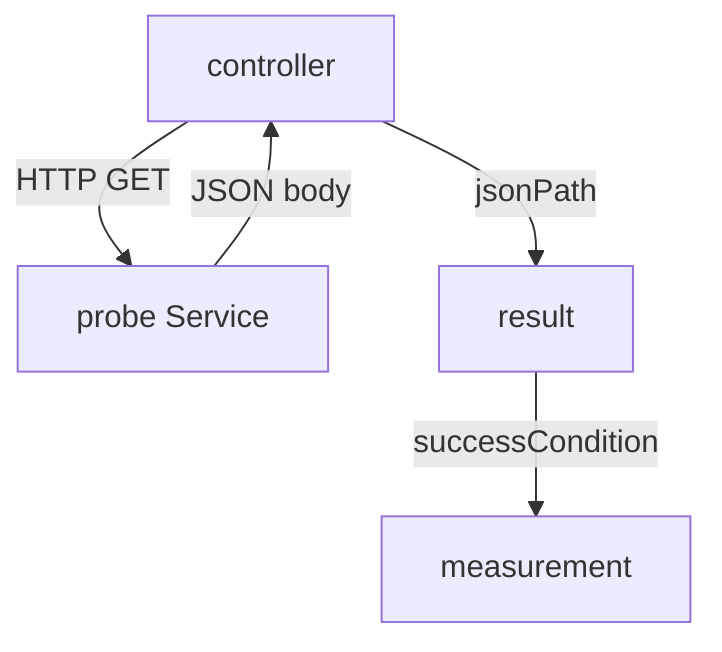

# The Web Provider

Many systems answer a metric question with an HTTP request that returns JSON. The `web` provider sends such a request from the controller and reads the answer. This part shows its fields and runs one measurement against the `probe` Service.

## What the provider does

The controller itself sends the HTTP request. No Job is created. The provider needs a `url`. It can send `headers`, a list of `key` and `value` pairs, for example an authorization header. The field `timeoutSeconds` limits the wait, and `insecure: true` skips the check of the server certificate. The field `jsonPath` selects one value from the JSON answer. Without it, the whole answer is the result.

The result is available as `result` in the conditions. If `jsonPath` selects a number, `result` is a number, and a condition such as `result == 200` works.

## A web measurement

The `probe` Service answers `/work?status=200` with a JSON body that contains the field `status` with the number 200. An `AnalysisRun` can hold the metrics itself, so no template is needed for a single check.

Save this as `analysisrun-web-check.yaml`:

```yaml
apiVersion: argoproj.io/v1alpha1
kind: AnalysisRun
metadata:
  name: web-check
  namespace: starfleet
spec:
  metrics:
  - name: probe-status
    count: 1
    failureLimit: 0
    successCondition: result == 200
    provider:
      web:
        url: http://probe.starfleet.svc.cluster.local:8080/work?status=200
        jsonPath: "{$.status}"
        timeoutSeconds: 5
```

<!-- astrona:playground:renew -->

Apply it:

```sh
kubectl apply -f analysisrun-web-check.yaml
```

Then check the result:

```sh
kubectl -n starfleet get analysisrun web-check -o jsonpath='{.status.phase}{"\n"}'
kubectl -n starfleet get analysisrun web-check -o jsonpath='{.status.metricResults[0].measurements}{"\n"}'
```

The first command prints the phase of the run. The second prints the measurement with the value that the controller read. A request that returns another status code in the field makes `result == 200` false, and the metric fails.



The diagram shows that the controller sends the request, selects the value and evaluates the condition itself.

## Where the controller runs

The request leaves from the controller pod, not from the pods of the application. The address must therefore be reachable from the `argo-rollouts` namespace, and a short Service name that works in the `starfleet` namespace does not work there. Use the full name `probe.starfleet.svc.cluster.local`.

## What you know now

The `web` provider is an HTTP request sent by the controller, with `jsonPath` to select the value. The condition reads the value as `result`. The next question is how a monitoring query is written.

## Common pitfalls

> [!WARNING]
> A `jsonPath` that selects nothing makes the measurement an error, not a failure. The `insecure` option removes protection against a false server, so use it only for tests. Secrets in `headers` are visible to anyone who can read the template; use an argument from a Secret.
