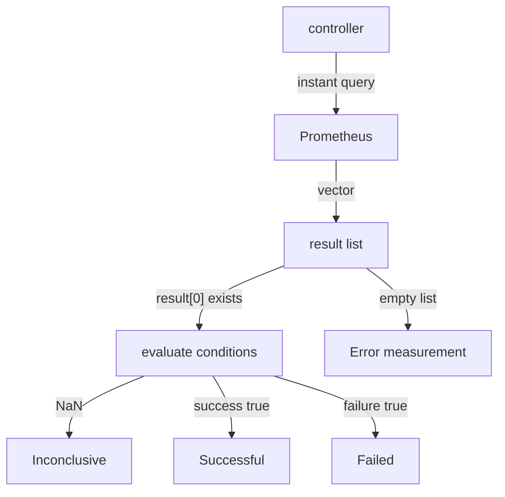

# The Prometheus Provider

Prometheus is a monitoring system that stores time series and answers queries in its own language, PromQL. The `prometheus` provider runs a PromQL query for each measurement. It is the most common provider in a real release, and also the one whose answer is easiest to misread, because the answer is a list and not a number. This part shows the fields, what the controller does with them on each measurement, the shape of the answer, and how the timing of the query and the timing of the canary must match.

## The fields

The provider needs an `address`, the URL of the Prometheus server, and a `query`. It may set `timeout` in seconds, `insecure` to skip the certificate check, and `headers` for extra request headers. The `authentication` block holds the settings for OAuth 2.0 or for AWS signing, when the server needs them. Arguments are used inside the query, for example to choose the canary pods:

```yaml
metrics:
- name: success-rate
  interval: 1m
  successCondition: result[0] >= 0.95
  failureLimit: 3
  provider:
    prometheus:
      address: http://prometheus.monitoring.svc.cluster.local:9090
      query: |
        sum(rate(http_requests_total{service="{{ args.service }}",code!~"5.."}[2m]))
        /
        sum(rate(http_requests_total{service="{{ args.service }}"}[2m]))
```

## What one measurement does

The controller takes a measurement on the schedule of the metric: the first one after `initialDelay`, the next ones every `interval`, until `count` is reached or the run is stopped. For each measurement, it substitutes the arguments into the query, sends an instant query to the Prometheus HTTP API at `address`, and waits for the answer within `timeout`. An instant query asks for the value of the expression at one point in time, now. The controller does not read a range of values; a range inside the query, such as `[2m]`, is computed by Prometheus.

Prometheus answers with a vector: a list of values, one for each time series that matches the expression. The provider converts this list into `result`, and the condition reads it. The controller then records the measurement with its phase, its value and its time in `status.metricResults` of the `AnalysisRun`.



The diagram shows the path of one measurement from the query to the phase that the controller records.

## The result is a list

A query with one series gives a list with one number, so the condition reads `result[0]`. A query that matches no series gives an empty list, and `result[0]` is then an error, which the controller records as an error measurement. Errors count against `consecutiveErrorLimit` (default 4), not against `failureLimit`. A query with no matching series therefore ends the metric in `Error` after the fifth error in a row, not in `Failed`.

For this reason a query usually ends with an aggregation such as `sum(...)`, so exactly one value comes back. The division of two sums in the example returns a single ratio. A division by zero in PromQL returns `NaN`, not an error. `NaN` satisfies no comparison, so with both a `successCondition` and a `failureCondition` set the measurement is `Inconclusive`, and with only a `successCondition` set it is `Failed`. A canary with no requests yet produces exactly this case.

<!-- astrona:playground:renew -->

The playground has no Prometheus server, so the example above cannot measure. The error path can be seen, and it is the one you meet first when an address is wrong. Save this as `analysisrun-prometheus-unreachable.yaml`. It queries a server that does not exist and allows no error:

```yaml
apiVersion: argoproj.io/v1alpha1
kind: AnalysisRun
metadata:
  name: prometheus-unreachable
  namespace: starfleet
spec:
  metrics:
  - name: success-rate
    count: 1
    consecutiveErrorLimit: 0
    successCondition: result[0] >= 0.95
    provider:
      prometheus:
        address: http://prometheus.monitoring.svc.cluster.local:9090
        query: sum(rate(lab_requests_total[2m]))
```

Apply it:

```sh
kubectl apply -f analysisrun-prometheus-unreachable.yaml
```

Then check the result:

```sh
kubectl -n starfleet wait --for=jsonpath='{.status.phase}'=Error analysisrun/prometheus-unreachable --timeout=120s
kubectl -n starfleet get analysisrun prometheus-unreachable -o jsonpath='{range .status.metricResults[*]}{.name} {.phase} errors={.error}{"\n"}{end}'
```

The run ends `Error`. The metric result shows the phase `Error` and an error count of one, and the measurement message, visible in the full YAML of the run, names the failed connection to the address. Nothing was measured, and no `failureLimit` was involved. With the default `consecutiveErrorLimit` of 4, the same run would retry the query and end `Error` only after five errors in a row.

Check the field list with `kubectl explain`, which reads it from the CRD:

```sh
kubectl explain analysistemplate.spec.metrics.provider.prometheus
```

The output lists `address`, `query`, `timeout`, `insecure`, `headers` and `authentication` with a short description of each.

## Measuring the right pods

A metric for the whole Service mixes the stable and the canary pods. During a canary at 20 percent, the numbers of the stable version make up 80 percent of the rate and can hide a problem in the canary. A better query selects the canary pods by a label. The Rollout can pass the hash of the canary ReplicaSet as an argument through `valueFrom.podTemplateHashValue: Latest`, and the query filters on the label `rollouts_pod_template_hash`. The label exists in Prometheus only when the scrape configuration copies the pod label `rollouts-pod-template-hash` onto the series, for example with `podTargetLabels` in a PodMonitor. This compares what the canary does and not what the average does.

## Timing

Prometheus computes a rate over a window, such as `[2m]`. A measurement 10 seconds after the canary starts sees a window mostly filled by the time before the canary existed, and a query filtered on the canary hash sees almost no samples and returns `NaN` or an empty list. Use `initialDelay` on the metric, at least as long as the window, to let the window fill before the first measurement. The `interval` sets how often the query runs after that, and `failureLimit: 3` in the example means the fourth failed measurement fails the metric, so a bad canary at one measurement per minute is aborted after about four minutes.

## What you know now

The `prometheus` provider sends an instant query to the Prometheus HTTP API on each measurement and turns the vector into `result`. Queries aggregate to one value, conditions read `result[0]`, an empty list is an error and not a failure, and `NaN` decides nothing. Arguments select the canary pods, and `initialDelay` keeps the first measurement out of an empty window. The next question is what other providers exist.

## Common pitfalls

> [!WARNING]
> A query with no matching series returns an empty list and the measurement is an error, counted by `consecutiveErrorLimit` and not by `failureLimit`. A rate over a window that is longer than the time the canary has run reports mostly the stable version or `NaN`. A very low `interval` can overload the Prometheus server.
